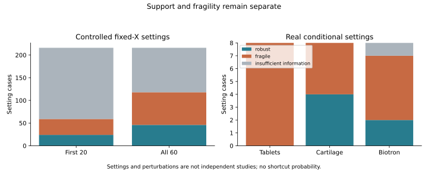

# nirs4all-domains

[](https://github.com/dcornet/nirs4all-domains/actions/workflows/ci.yml)

**Characterizing spectral structures that may enable shortcut learning in NIRS datasets.**

**Alpha.14** separates the public scientific corpus, the authorized confidential
corpus and disclosure-reviewed public synthesis. The pinned catalog remains the
screening population (164 entries, including 122 private-tier entries); access,
local execution, publication and independent-study counts have separate meanings.
Private tier alone neither prohibits analysis nor grants rights.

The shared native X-only pipeline needs neither targets nor physical identifiers
for descriptive geometry. Local-private source data stay in their authorized
cache; confidential evidence, scoped HMAC identities and mapping secrets stay
outside Git. Numerical success never triggers public export. A closed export
schema, explicit source permissions, exact-byte review, cumulative disclosure
review and outgoing Git/package checks guard publication. These controls do not
establish anonymity, differential privacy or biological independence.

[Private corpus protocol](docs/ALPHA14_PRIVATE_CORPUS_PROTOCOL.md) ·
[disclosure policy](docs/ALPHA14_DISCLOSURE_POLICY.md) ·
[full-bank screening](docs/ALPHA14_FULL_BANK_SCREENING.md) ·
[public synthesis](docs/ALPHA14_PUBLIC_SYNTHESIS.md).
Detailed private findings are retained locally and are not automatically released.
The alpha.12/13 H1–H5 contracts remain frozen; X-only clustering does not establish
shortcut learning or supervised confirmation.

Alpha.14 passes **338 local tests (303 Python + 35 Rust)** and 24 release gates,
including actual wheel/sdist and public-source checks. Both
[Windows and Ubuntu CI jobs passed](https://github.com/dcornet/nirs4all-domains/actions/runs/39125572748)
on release source `5495ed4`, with 338 actual tests per platform and public/synthetic
inputs only. [Completed-job proof](docs/audit/github-ci-alpha14.json) and the
[A–J release report](docs/ALPHA14_RELEASE_REPORT.md) distinguish that validation
from the protected scientific execution preserved at source `c3104f8`.

**Alpha.13:** an independently versioned exposure-calibrated stability design
uses 60 whole-component draws. Nine controlled mechanisms receive 6,498 PCA fits;
three real source views receive 720 refits, yielding 6 robust, 17 fragile and one
insufficient setting, with no all-combination robust source. Alpha.12 is unchanged.

Two new material-family views add complete raw/SNV evidence for **310 tablets ×
404 bands** and **108 soil observations × 700 bands**. Original-key projection
matches all 310 tablet spectra without target reads. All 164 catalog entries are
reviewed, including original public-source permissions for these private-tier
views. The bank has 41 characterized views, without claiming 41 independent
studies. H1–H5 have a frozen operational falsification contract; original physical/
reference closure still blocks the optional supervised pilot. No new real
supervised fits or TabPFN.

nirs4all-domains characterizes structural properties of NIRS datasets that may
enable shortcut learning, using spectral geometry, neighborhoods, representation
sensitivity, structural stability and evaluation-support evidence. These
predominantly unsupervised findings generate hypotheses that can be tested later
through independently designed supervised generalization experiments.

[Power and real results](docs/ALPHA13_STABILITY_POWER_RESULTS.md) ·
[bank extension](docs/ALPHA13_UNSUPERVISED_BANK_EXTENSION.md) ·
[source audit](docs/ALPHA13_SOURCE_DIVERSITY_AUDIT.md) ·
[confirmation feasibility](docs/ALPHA13_CONFIRMATION_FEASIBILITY.md) ·
[A–J release report](docs/ALPHA13_RELEASE_REPORT.md).



Run `python scripts/check_alpha13_results.py --require-complete` for portable
scientific evidence checks. Add `--require-local-preservation` in the original
workspace to verify every historical local cache artifact. Native reconstruction
requires exact authorized sources/providers. Actual local/package and hosted CI
execution evidence are recorded in [validation](docs/VALIDATION.md).

Local alpha.13 validation passes **279 tests: 35 Rust + 244 Python**, all 19
release checks and isolated wheel/source parity, preserving all protected history.
[Windows and Ubuntu CI passed](https://github.com/dcornet/nirs4all-domains/actions/runs/39113244041)
on scientific source `037aafa`, with 279 actual tests on each platform;
[completed-job evidence](docs/audit/github-ci-alpha13.json) records their logs.

## Historical alpha.12

**Alpha.12:** 39 of 42 public entries have full-population raw/SNV geometry,
22 have complete-source full-axis neighborhoods and 17 have prespecified query
samples against complete references. Seven selected views have 560 actual PCA
resampling refits; none meets every frozen stability gate. Limited pair support
and representation sensitivity are scientific findings, not shortcut probabilities.

The [evidence matrix](docs/benchmarks/alpha12/COVERAGE.md),
[comparative results](docs/ALPHA12_CROSS_DATASET_RESULTS.md),
[figure](docs/benchmarks/alpha12/figures/representation-sensitivity.svg) and
[A–J report](docs/ALPHA12_RELEASE_REPORT.md) retain source identities, hashes,
unknown population overlap and explicit missingness. Thirty-seven sources have
variable metadata agreement. Two malaria entries remain unavailable; simulated
MIR/Raman remains ineligible. No new real supervised models or TabPFN run here.
Frozen unsupervised hypotheses await independent study-level confirmation.

Local validation passes **225 tests: 35 Rust + 190 Python** and all 18 release
checks; every one of 371 protected historical files is unchanged. Package/source
parity and hosted CI conclusions are recorded in the linked validation evidence.
[Windows and Ubuntu CI passed](https://github.com/dcornet/nirs4all-domains/actions/runs/39059440119)
on scientific source `8a1d53e`, with all 225 tests on each platform.

Run `python scripts/check_alpha12_results.py --require-manifest` for portable
evidence checks. Numerical reconstruction additionally requires exact authorized
caches/providers. [Validation](docs/VALIDATION.md) records actual tests and CI.

## Purpose and historical alpha.11 evidence

Domains characterizes structural properties of NIRS data that may enable
shortcut learning, using spectral geometry, neighborhoods, split support, target
associations and predictive stress tests whenever the required information is
available. **X-only analysis does not require targets, explanatory metadata or
verified physical identities.** These remain necessary for stronger interpretations
and valid independent-sample prediction. Structural susceptibility, target
association and demonstrated model dependence are separate evidence levels.

**Alpha.11 covered all 42 pinned public catalog entries:** 37 execute complete-source
X geometry; five retain explicit source/access/rights/dimension blockers. There
are 35 metadata agreement profiles, two split-support cases, two original-keyed
X-partition/target cases, three target/factor cases and two public model cases
(including reused CA2023 evidence). Preparations, targets and repeated designs
do not count as independent scientific populations. See the
[coverage matrix](docs/benchmarks/alpha11/COVERAGE.md) and
[adaptive protocol](docs/ALPHA11_ADAPTIVE_CAMPAIGN_PROTOCOL.md).

New litter nitrogen evidence preserves **322 intact samples / 321 ground
counterparts / 2001 bands**, with 298 development and 24 retained samples.
Three fixed grouped designs repeat complete native selection/refitting:

| Pipeline | Intact RMSE range | Ground-preparation RMSE range |
|---|---:|---:|
| Raw PLS | .315–.340 | .447–.837 |
| Nested Ridge | .187–.255 | .596–.820 |
| Native SNV/PLS | .263–.292 | .735–.858 |

Units are nitrogen dry-mass percentage points; exact matched populations and
per-design outcomes are preserved. Better intact prediction does not guarantee
preparation transfer. The 24 development blocks are declared plots/contexts;
GEN collection and assay links remain unresolved. Refit sensitivity is descriptive,
separate from conditional OOF bootstrap. **No low-dependence certificate.**
Crop nitrogen adds descriptive original-keyed association; Cartilage adds X-only
geometry while donor/assay evidence still blocks modeling. Source isolation is
adversarially verified, with an explicit correction to the initial paired-source
audit. [Full alpha.11 report](docs/ALPHA11_RELEASE_REPORT.md).

Historical alpha.11 gates passed **173 tests: 35 Rust + 138 Python**, retaining every
baseline test and all 224 protected files. TabPFN is a
[frozen future study](docs/ALPHA11_TABPFN_STUDY_PLAN.md), without installation,
weights or predictions. [Completed Windows/Ubuntu CI](https://github.com/dcornet/nirs4all-domains/actions/runs/39043282178)
validates scientific source `666f43f`; [validation](docs/VALIDATION.md) records
the actual jobs, test logs and package/source parity.

## Historical alpha.10 estimator comparison

Alpha.10 compares **estimator and pipeline responses to the same structural
stress**. Perten moisture preserves all 450 specimens: 359 development records
in 17 conservative context blocks, with 91 retained outcomes sealed. Historical
PLS/fixed Ridge remain unchanged; new configurations use identical frozen outer
and group-safe inner evaluations.

| Pipeline | Reference RMSE | Cereal holdout | Instrument holdout |
|---|---:|---:|---:|
| Historical PLS | 2.39 | 5.09 | 3.49 |
| Historical fixed Ridge | 2.62 | 2.85 | 3.43 |
| Nested-selected Ridge | 1.88 | 2.95 | 3.04 |
| Native SNV/PLS | 1.82 | 3.06 | 2.45 |
| nirs4all FastAOM hard chain | 2.01 | 1.50 | 2.02 |
| nirs4all FastAOM sparse MKR | 2.53 | 2.60 | 2.02 |

Units are source moisture percentage points. Tuning, preprocessing and adaptive
operator selection change the observed response. A separate exact-size control
also covers all 359 IDs. **Only two cereal closure units** support these transfer
directions: paired context intervals do not describe arbitrary unseen cereals.
Better FastAOM performance does not establish lower structural dependence.
**No low-dependence certificate has been issued.**
See [matched results, uncertainty and measured costs](docs/ALPHA10_MULTIFAMILY_RESULTS.md)
and [the frozen protocol](docs/ALPHA10_MULTIFAMILY_PROTOCOL.md).

The disk-first P0–P4 bank remains bounded and resumable. The pinned catalog has
**164 datasets / 171 sources / 1,936 declared targets**; alpha.9 screens all 42
public entries and re-audits four private candidates. Numeric specimen codes do
not qualify as chemical outcomes. Perten's official CC-BY-4.0 rights and original
IDs resolve stale catalog blockers; CORN, Shootout and UCPH still need original
keys or reuse permission. **No new paired-source task is qualified.** Cartilage's
original revised CC0 MAT now verifies **869 keyed locations / 2,605 spectra /
44 regions / five joints** and all derived spectral memberships. Its derived Y
is unkeyed; joint-to-animal and assay dependencies remain unresolved. No Cartilage
predictive fit is run, and no population is truncated to the old 500-row guard.
Previously weak prediction remains an unresolved observation.
Full-bank scientific qualification remains incomplete; see
[admission evidence](docs/audit/alpha9-source-admission.json).

GitHub contains source and compact evidence. Datasets owns verified scientific
source/canonical storage; local tools, scratch and historic results can be much
larger. The corrected Windows audit measured **11.51 GB logical / 11.08 GB unique
file allocation**, including **3.07 GB results**; reusable tools/build/Python/
upstream audits dominate. The 137.56 MB EcoSIS report has an enriched **2.69 MB**
compact record, including association/within-group context, with the original
preserved. **No existing bytes were deleted or migrated.**
See [storage audit](docs/LOCAL_STORAGE_AUDIT.md) and
[retention/replay limits](docs/STORAGE_AND_REPRODUCIBILITY.md).
Alpha.9 adds about 12.69 MB of local pilot files and 1.30 MB in one external
Datasets cache revision. Compact task evidence, including identical shared local
exports, occupies 4.06 MB against the reviewed 4 MiB cap. Historical outputs are
preserved. [Measured bytes](docs/audit/alpha9-storage.json) distinguish these
figures from fixed Rust/tooling costs.
Alpha.10 adds one 26.66 MB original MAT cache and about 175 MB of isolated optional
runtime; versioned Rust builds dominate further growth. The owner reviewed two
workspace-ceiling increases while retaining the scientific task/campaign caps.
See [alpha.10 storage evidence](docs/audit/alpha10-storage.json).

With the optional bridge installed, these commands perform no acquisition or fit:

```sh
python -m nirs4all_domains.bank inventory --catalog-root /local/pinned/datasets --out results/catalog-inventory.json
python -m nirs4all_domains.bank query --registry docs/benchmarks/alpha10 --purpose within_population_estimator_comparison
python -m nirs4all_domains.bank verify --manifest docs/benchmarks/alpha10/storage.json --root docs/benchmarks/alpha10
python -m nirs4all_domains.bank freeze-suite --registry docs/benchmarks/alpha10 --purpose within_population_estimator_comparison --metrics configs/bank/taskwise-rmse-v1.json --out results/my-frozen-suite.json
python -m nirs4all_domains.bank plan-task --task tests/fixtures/dependence/mixed.json --config configs/pilots/split-stress-controls-v1.json --out results/bank-plan.json
python -m nirs4all_domains.bank estimate --plan results/bank-plan.json --policy configs/bank/storage-policy-alpha10.json --workspace . --scratch results/bank-scratch --evidence results/bank-evidence
```

`/local/pinned/datasets` is an explicit input checkout. The example policy records
this owner's reviewed local budget; measure your workspace and edit its ceiling
for another deployment. Estimates account for partial/shared files and return
`insufficient_storage` or `budget_exceeded`. The serialized scheduler resumes
stages and publishes validated atomic outputs. `cleanup-plan` checks explicitly
owned scratch against frozen/reference/running manifests and has **no deletion
operation**. See `python -m nirs4all_domains.bank cleanup-plan --help` and
[the bank model](docs/BENCHMARK_QUALIFICATION_MODEL.md).

A predictive model can perform well because it recognizes sample groups,
instruments, batches or spectral neighbors. That performance may not transfer
outside those structures. Domains develops reproducible diagnostics and
controlled evaluation protocols to investigate this distinction. Group structure
can also carry genuine chemistry: the objective is to measure dependence on
structure, without claiming causal identification of the underlying mechanism.

## Quick start

In this prepared Windows workspace:

```powershell
. .\scripts\dev-env.ps1
cargo build --workspace --locked
target\debug\n4domains.exe validate tests/fixtures/translation.json
target\debug\n4domains.exe analyze tests/fixtures/translation.json --out results/alpha5-quickstart/translation
target\debug\n4domains.exe structure tests/fixtures/structure/separated.json `
  --config configs/pilots/structure-v1.json --out results/alpha5-quickstart/structure
```

Structural output directories must be new. Structure, canonical coverage and the
optional predictive workflow emit separate versioned reports. See [setup](docs/INTEGRATION.md)
and [the frozen structural protocol](docs/CLUSTERING_STABILITY_PROTOCOL.md).

## Scientific motivation

Random splits may place repeated spectra, related physical samples or shared
laboratory references on both sides of an evaluation. Even without direct
leakage, a split can preserve group-specific X–Y relationships that disappear
when instruments, batches, sites or subpopulations change.

Dataset topology therefore matters alongside regression metrics. Predicting
between-group differences is different from predicting within-group variation.
Good regression performance alone does not establish a transferable trait
relationship. Stable X clusters alone do not establish shortcut learning.
Domains keeps intrinsic properties, structural associations, split effects and
predictive reliance as distinct scientific questions.

## Implemented features

The scientific workflows retain the qualified alpha.4–alpha.7 protocols:

- Explicit versioned dataset/content/source/target/split/policy contracts.
- Physical/reference dependency checks, strict split guards and keyed joins.
- Native acquisitions and admissible homogeneous technical means, with membership,
  evidence, linked contexts and explicit exclusions.
- Train-fitted Methods PCA and held-out projection; heuristic neighbor/residual
  coverage; whole-component uncertainty and train-fit stability experiments.
- Separate train-only PCA–HDBSCAN–ARI characterization through Methods ABI 2.19:
  component subsampling, matched physical IDs, noise diagnostics, co-membership
  support, frozen parameter sensitivity and exploratory structural classification.
- Physical consensus for a bounded native-acquisition comparison.
- Reproducible JSON/Markdown reports, schemas and real Shootout/EcoSIS pilots.
- Optional development-only nested grouped PLS through DAG-ML and native Methods,
  with fold-local centering, selection and a fold-local mean baseline.
- Native metadata group–target association, physical-unit SS decomposition and
  whole-component uncertainty, with explicit saturated/missing-factor limits.
- Matched group-only, null, spectral and group+residual OOF predictions. Group
  means and residual targets are fitted independently in every inner/outer scope;
  unseen labels use the training global mean. Seen-level skill has its own
  eligibility and denominator.
- Algorithmic exclusion of retained Y_test from pre-training fits and selection.
- Separate split stress: preserved reference folds, prespecified seeds,
  whole-component shuffle, transitive factor holdout, size-matched evaluation
  intersections and post-evaluation target-range diagnostics.
- Training-target interventions rebuilt independently inside every native inner
  and outer fit. Original validation outcomes remain the scoring reference;
  exchangeability, failed attempts and actual perturbation strength are explicit.

HDBSCAN held-out assignment remains **unavailable**. No train+test fit is presented
as cluster prediction. Canonical slots for separate structural/predictive
workflows retain their earlier availability semantics.

## Structural shortcut risk research programme

| Experiment | Status |
|---|---|
| Unsupervised X structure and resampling stability | Implemented, separate alpha.5 report |
| Descriptive metadata-group/target variance decomposition | Implemented alpha.6; complete factor/target physical units only |
| Group-only prediction versus null and spectra | Implemented alpha.6; explicit seen/unseen fallback and matched OOF |
| Within-group predictive skill | Implemented alpha.6; qualified seen-level populations and fold-local residual fitting |
| Component-safe random and true factor-holdout sensitivity | Implemented alpha.7; closure, matched populations and size/range controls |
| Global training-target intervention | Implemented alpha.7; 19 effective EcoSIS attempts |
| Within-factor training-target intervention | Qualified on synthetic controls; unavailable on EcoSIS under strict inner-scope power gates |

The [research specification](docs/STRUCTURAL_SHORTCUT_RISK.md) defines metrics,
populations, fold ownership, negative controls and gates. Eta-squared alone will
not establish predictive reliance. Spectral-group baselines require fold-local
construction and qualified held-out assignment. No universal shortcut probability
or calibrability ranking is provided.

Try the bounded workflow after installing the predictive bridge:

```sh
target/debug/n4domains dependence tests/fixtures/dependence/mixed.json --config configs/pilots/dependence-controls-v1.json --out results/dependence-demo --python python
python scripts/check_dependence_report.py results/dependence-demo/report.json
```

The output directory must be new. A metadata audit is written before fitting;
`--audit-only` stops there. `group-target` exposes the native-backed descriptive
slice separately. [Protocols](docs/STRUCTURAL_PREDICTIVE_BASELINES.md) describe
the exact populations, fold-local lineage and no-fit constant-residual case.

```sh
target/debug/n4domains split-stress tests/fixtures/dependence/mixed.json --config configs/pilots/split-stress-controls-v1.json --out results/split-stress-demo --python python
python scripts/check_split_stress_report.py results/split-stress-demo/report.json
```

The [frozen split protocol](docs/SPLIT_STRESS_ALPHA7_PROTOCOL.md) distinguishes
plot-grouped evaluation from genuine genus holdout. Size controls match training
sample counts on evaluation intersections; training-target interventions change
training relationships while preserving original evaluation truth. These tests
answer different questions, and a decline alone cannot establish shortcut learning.

## Architecture and ecosystem

| Project | Responsibility |
|---|---|
| nirs4all-methods | Numerical PCA, summaries, neighbors, HDBSCAN, ARI, regression and association kernels |
| nirs4all-preflight | Intrinsic validity, identities, repetitions and descriptive characterization |
| nirs4all-domains | Task-specific structure, split/generalization protocols, evidence and provenance |
| nirs4all-datasets | Canonical data, catalog versions, accessors and provenance |
| DAG-ML | Native CV, model selection and refit in the optional predictive workflow |
| nirs4all-quality | Potential operational consumer; no integration claimed here |

Two Rust crates remain the core and CLI. Python provides keyed transport, batch
orchestration and a bounded native predictive adapter, without numerical fallbacks.
The explicitly requested optional nirs4all FastAOM candidate owns its upstream
Python/NumPy/SciPy calculations. It is distinct from native Methods FastAOM
facades; its isolated public-entry deployment is qualified separately from the
full nirs4all application. TabPFN is a planned, separate study and is not run.
See [architecture](docs/ARCHITECTURE.md) and [method ownership](docs/METHOD_REUSE_MATRIX.md).

## Setup on Windows and Linux

Use Rust with a native linker and Python 3.11+ for optional workflows. Preflight
is pinned to `=0.1.0-alpha.1`. Tested Methods: `nirs4all-methods==1.3.6`, ABI
**2.19.0**. Structure requires ABI >=2.19; canonical coverage supports >=2.18.
Optional extras pin Datasets 0.3.11, DAG-ML 0.3.41 and scikit-learn 1.7.2
(Methods estimator facade base classes only, not a numerical backend).

```sh
python -m venv .venv
# Activate .venv/bin/activate on Linux, or .venv/Scripts/Activate.ps1 on Windows.
python -m pip install nirs4all-methods==1.3.6 './bridges/python[test,datasets,predictive]'
python -c 'from n4m._ffi import library_path; print(library_path())'
cargo build --workspace --locked
```

Select the printed library with `--methods-library` or
`N4DOMAINS_METHODS_LIBRARY`. On Windows, also add the sibling
`nirs4all_methods.libs` directory to PATH; `scripts/dev-env.ps1` handles this
prepared workspace. On Linux the executable is `target/debug/n4domains`.
Missing providers/capabilities yield explicit reasons, without numeric substitutes.

```sh
target/debug/n4domains batch --catalog-config configs/synthetic-batch.yaml --out results/synthetic
target/debug/n4domains batch --catalog-config configs/pilot.yaml --catalog-root /prepared/catalog --out results/pilot
target/debug/n4domains schema --out schemas
```

Batch requires the installed Python bridge; `--python` selects its interpreter.
The real catalog path is an explicit local input. CORN/UCPH remain disabled with
prerequisites in [the historical pilot](docs/REAL_DATA_PILOT.md). Data preparation
is documented in [the repeated pilot](docs/REPEATED_DATA_PILOT.md).

## Real-data evidence

| Task | Population / split | Exploratory outcome |
|---|---|---|
| Shootout X1 / assay | 155 train, 460 test; 40 validation exclusions | 73/460 coverage flags; both singleton representations agree |
| EcoSIS freeze-dried / LMA | 82 samples, 492 acquisitions; 65/17 primary sample split, 45/12 plots | 16/102 acquisition flags versus 4/17 mean flags; same four physical samples |
| EcoSIS development PLS | 65 means / 45 plots; five outer, three inner group folds | OOF RMSE 110.87 versus null 146.99 g/m²; R² 0.397 |
| EcoSIS train structure | 65 means / 45 components; 100 paired 80% subsamples, five settings | Insufficient information: primary all-noise; smaller clusters appear with weak sensitivity support |
| Shootout train structure | 155 source-row identity aliases; same structural design | Fragile structure: primary three groups, 27.10% noise; median eligible ARI 0.533 |
| Perten moisture / context-safe development | 359 specimens / 17 blocks; 91 retained outcomes sealed | PLS RMSE 2.387 versus null 3.353 source percentage points; R² .484 |
| Perten cereal / instrument holdout | Same 359 IDs; two cereal closure units, six instrument-model strata | PLS RMSE 5.086 / 3.492; fixed Ridge 2.847 / 3.434; size control covers only 38 IDs / two blocks |
| Perten unavailable diagnostics | Same frozen conservative blocking policy | HDBSCAN stability needs 20 components; all six target-intervention attempts unavailable under whole-vector gates |
| EcoSIS genus baseline | Same 65 development means / 45 plots; 55 seen-level OOF samples | Group RMSE 114.78; group+residual 101.35 g/m²; exploratory paired gain 13.43 [0.60, 26.08] |
| EcoSIS true genus holdout | Same 65 means; 14 closure units, five outer folds | Spectral RMSE 142.72 versus frozen 110.87; target extrapolation rises from 2/65 to 7/65 |
| EcoSIS size-controlled comparison | 45 matched evaluation means / 29 components | Spectral RMSE 85.41–118.60 versus holdout 144.05 on those same IDs; partial population, remaining distribution differences |
| EcoSIS global training intervention | Same reference validation IDs; 19 effective attempts | Spectral median RMSE 139.16; within-genus intervention unavailable in two inner fit scopes |

These are not established production or new-region performance. Coverage
fractions have different denominators and are not prediction-failure probabilities.
All 390 primary train acquisitions and 2151 bands remain in native coverage;
unavailable full moments do not block scores/coverage. See [predictive evidence](docs/PREDICTIVE_SANITY_CHECK.md)
and [actual structural results](docs/CLUSTERING_REAL_DATA_PILOT.md).
The [alpha.6 pilot](docs/STRUCTURAL_DEPENDENCE_REAL_DATA_PILOT.md) separates
association (genus eta²=.608 on 61 nonmissing means) from prediction on all 65.
Plots have eta²=.709 but every OOF plot is unseen, so their group baseline is
exactly the null. Taxonomic labels predict variation; this does not identify
shortcut learning, causal confounding or a fraction of chemical information.
The [alpha.7 pilot](docs/SPLIT_STRESS_REAL_DATA_PILOT.md) reports all six reference
seeds (spectral RMSE 85.75–115.04), true holdout, size/range alternatives and
effective global interventions. The observed sensitivity is compatible with
structural dependence; small samples, Y composition and biological shifts remain
alternative explanations. No chemical percentage or causal effect is identified.

## Scientific limitations

Coverage thresholds are heuristic. Metadata may not establish biological
independence, replicate subtypes or independent laboratory precision. Stable X
groups do not prove target confounding, predictive reliance or causality. Grouped
development CV is not production calibration. Structural categories are
operational and sensitive to native ordering/tie conventions at specified scales.
All-noise or a trivial cluster is not proof of stable grouping or a continuum.
Held-out HDBSCAN labels remain unavailable.

Datasets' public target accessor may materialize a full frame: algorithmic label
exclusion is tested, storage isolation is not promised. See [protocols](docs/SCIENTIFIC_PROTOCOLS.md),
[upstream proposals](docs/UPSTREAM_DEPENDENCIES.md) and [roadmap](docs/ROADMAP.md).

## Verification and project status

Historical **0.1.0-alpha.10**. **35 Rust + 117 Python = 152 tests passed locally**,
preserving all 129 alpha.9 tests. Native gates, schemas, bridge/report checks and
177 historical artifact hashes pass. All 2,154 historical anchor predictions
replay exactly; adaptive replay uses its declared 1e-9 tolerance.
[Full alpha.10 A–J report](docs/ALPHA10_RELEASE_REPORT.md) and
[validation evidence](docs/VALIDATION.md) record actual hosted execution separately.
[Windows and Ubuntu CI passed](https://github.com/dcornet/nirs4all-domains/actions/runs/39029167305)
on scientific source `d122124`, with all 117 Python tests on each platform.

Historical alpha.9:
[Actual alpha.9 Windows/Ubuntu CI passed](https://github.com/dcornet/nirs4all-domains/actions/runs/39020893216)
on scientific source `e711cc8`. [Full A–J report](docs/ALPHA9_RELEASE_REPORT.md)
and [validation evidence](docs/VALIDATION.md) retain the incomplete paired-source
scope and scientific limits. The alpha.8 baseline is
**35 Rust + 70 Python = 105 tests**, all preserved.
[Alpha.8 Windows/Ubuntu CI passed](https://github.com/dcornet/nirs4all-domains/actions/runs/39017764273)
on source commit `1b6cfc7`. Execution details are in [VALIDATION.md](docs/VALIDATION.md). All 123 frozen files
are retained. Representative real holdout/intervention cells replay exactly;
compact evidence requires authorized local input/cache for reconstruction and
does not promise complete historical replay.
[Alpha.7 Windows/Ubuntu CI passed](https://github.com/dcornet/nirs4all-domains/actions/runs/39011303916)
on source commit `f50d463`. Detailed execution evidence is in
[VALIDATION.md](docs/VALIDATION.md); the badge links the actual workflow.

```sh
cargo fmt --all --check
cargo clippy --workspace --all-targets --locked -- -D warnings
cargo test --workspace --locked
# Requires real N4DOMAINS_METHODS_LIBRARY, including ABI 2.19 structure gates:
cargo test --workspace --locked -- --ignored
cargo doc --workspace --no-deps --locked
# Set N4DOMAINS_BIN to the built CLI:
python -m unittest discover -s tests/integration -v
```

Provider-free tests do not qualify unavailable methods. CI executes real native
gates on Windows and Ubuntu. Validate structural output with
`python scripts/check_structure_report.py <report.json>`.
The [alpha.8 design](docs/ALPHA8_MULTIDATASET_PROTOCOL.md) and
[external Datasets sidecar](docs/DATASETS_SIDECAR_INTEGRATION.md) separate the actual
partial campaign from future full-bank qualification.

License: **AGPL-3.0-or-later**, selected by the owner. Native upstream libraries
and raw dataset bytes are not redistributed here. No upstream repository was modified.
