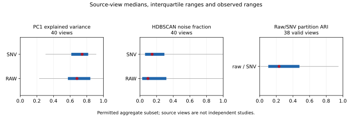

# Alpha.17 scientific comparison of the existing bank

## Approved extension and first predictive experiment — 2026-10-19

The current bank has **56 characterized source views** and **42 views with
publishable ordinary aggregates**. Across 171 declared views the execution
accounting is 56 computed, 16 failed, four unavailable and 95 not executed.
The original 53-view/40-permitted-view synthesis below is preserved separately.
[Extension JSON](benchmarks/alpha17/X-extension-summary.json) contains the updated
42-view distributions and all eight approved attempt outcomes. Median raw PC1
remains 0.68234; median raw/SNV ARI is now 0.22665 on 40 evaluable views.

The eight-view extension computed three full raw/SNV views (six PCA profiles,
12 fixed clustering attempts) and retained five failures. Two axes fail the
strictly increasing-axis contract, without silent sorting or dropped bands.
Three initial native starts failed because the repaired-wheel DLL directory
was absent from the child environment. That transport cause was corrected for
subsequent views; the failed attempts were not retried or hidden.

| Newly published source | n × p | Raw → SNV PC1 | Raw/SNV ARI | Raw → SNV clusters |
|---|---:|---:|---:|---:|
| AQGRAD | 190 × 2101 | .52173 → .84009 | .22612 | 4 → 7 |
| Floating/emergent macrophytes | 325 × 1024 | .81691 → .62666 | −.01722 | 5 → 2 |

Observation: SNV changes variance concentration and clustering in opposite
directions across these two sources. Confidence: native, complete-population
descriptions; neither source views nor cluster labels establish independent
studies. Consequence: preprocessing sensitivity is not a universal scalar risk
direction. Action: retain both representations and contrary cases before outcomes.

The source API declares [AQGRAD](https://data.ecosis.org/api/3/action/package_show?id=leaf-reflectance-and-traits-of-plants-sampled-along-a-water-affinity-gradient--aqgrad-)
and [macrophytes](https://data.ecosis.org/api/3/action/package_show?id=leaf-reflectance-and-tratis-of-floating-and-emergent-macrophytes)
under [CC BY-NC 2.0](https://creativecommons.org/licenses/by-nc/2.0/).
These derived research statistics retain the attribution and noncommercial
conditions; full creator/title/citation notices are in the JSON. Software
licensing is unchanged. The third new view's aggregate permission remains
unresolved; its full scientific result stays in the authorized local report.
The catalog private tier itself is not the publication criterion.

The separately approved [tablet experiment](ALPHA17_TABLET_PILOT_RESULTS.md)
executes 104 native model fits and four train-only ACP/PCA fits on all 310 × 404
observations/bands. Pooled skill is positive but a complete original context has
negative R² for both anchors. This is new exploratory predictive knowledge paired
with frozen X descriptors, without a matched stress/control or independent-study
claim. No H1–H5 definition, descriptor or threshold changes.

## Initial existing-evidence synthesis — preserved scope

The analysis reuses **53 actually characterized source views**, from a catalog
of 164 datasets with 159 locally authorized entries. These are different units:
source views, entries and independent studies must not be conflated. The local
comparison retains all 53 views. The public aggregate subset has **40 views**
covered by established source permissions, each with raw and SNV profiles.
No catalog-private veto, recurring owner byte approval or small-cell suppression
is applied to ordinary source-permitted metrics.

The frozen catalog has **171 declared source views**: 53 computed, 11 with a
recorded failed execution, four unavailable and 103 not executed. These are
operational execution states, not verdicts that a failed source is scientifically
unusable. Unchanged failures are not retried in the current extension proposal;
their records and the full-bank denominator remain intact.

All observations and wavelengths represented by each original profile remain.
This phase makes no new spectral fit and does not extrapolate missing full
covariance moments from truncated PCA. Unexecuted bank entries remain unexecuted;
this is not a claim of complete bank coverage.

| Descriptor | Views evaluated | Median | Interquartile range | Observed range |
|---|---:|---:|---:|---:|
| Raw PC1 explained variance | 40 | 0.6823 | 0.5732–0.8426 | 0.2275–0.9999 |
| SNV PC1 explained variance | 40 | 0.7444 | 0.6140–0.8171 | 0.3044–0.9142 |
| Raw HDBSCAN cluster count, primary setting | 40 | 2 | 2–3.25 | 0–20 |
| Raw primary-setting noise fraction | 40 | 0.0965 | 0.0274–0.3177 | 0.0028–1 |
| Raw/SNV partition ARI | 38 | 0.2331 | 0.1038–0.4783 | 0.0084–0.9478 |
| Raw/SNV k=8 neighbor-set overlap | 40 | 0.3150 | 0.2831–0.3840 | 0.0459–0.7098 |
| Raw effective dimension from exact full moments | 14 | 1.6730 | 1.3919–2.2669 | 1.0063–4.9763 |

Fractional cluster-count quartiles describe a distribution across views; they
are not fractional clusters in an individual dataset. Two ARI values lack shared
nontrivial partition support. Exact effective dimension is unavailable for 26
views because the squared covariance trace exceeds its existing work budget.
Those missing values do not disable their PCA or neighborhood results.

Calibrated B60 resampling stability remains in its separate historical receipts;
the 53 views do not all have that coverage. Raw/SNV ARI measures representation
agreement and is not a substitute for H1 resampling stability. No missing
stability result is represented as zero or silently qualified by alpha availability.

## Findings and limits

**Observation:** spectral variance is often concentrated in PC1, while raw/SNV
partition agreement and neighbor overlap vary widely. **Confidence:** descriptive
for the evaluated source views, not an estimate for all NIRS studies.
**Consequence:** PCA concentration, cross-representation partition agreement and local-neighborhood
preservation are distinct empirical descriptors. **Action:** retain all three
when comparing later predictive responses, including contrary cases.

**Observation:** native absolute-Pearson filters do not exceed 0.5 for any of
the three prespecified raw pairs: PC1/proximity(.01), PC1/raw-SNV ARI, and
proximity(.01)/raw-SNV ARI (40, 38 and 38 matched views). **Confidence:** only the
published native threshold decision; no signed coefficient or p-value is exposed.
**Consequence:** this subset does not support treating these descriptors as
interchangeable. **Action:** test their separate prospective associations with
matched predictive outcomes; this screen is not itself a test of shortcut learning.

**Observation:** paired SNV-minus-raw PC1 changes range from −0.5625 to +0.2994,
with median +0.0467. **Confidence:** matched-view descriptive evidence.
**Consequence:** SNV is not a uniformly variance-removing operation at the
dataset-profile level. **Action:** keep the frozen raw/SNV contrast without
choosing preprocessing from future outcomes.

**Observation:** at the fixed registered relative radius .01 × sqrt(full trace),
mean proximity is 0.0606 raw versus 0.000782 after SNV, while mean PC1 fractions
are similar (0.6967 versus 0.6983). **Confidence:** descriptive across the same
40 views; proximity's median and upper quartile are zero in both representations,
so the means reflect relatively few dense views. **Consequence:** a single PCA
summary cannot stand in for neighborhood geometry. **Action:** report the full
distribution and representation-specific normalization, without interpreting
spectral proximity as proof of repeated physical specimens.

**Observation:** excluding the catalog's vegetation family leaves only three
views and shifts raw PC1 median to 0.9200, compared with 0.6823 overall.
**Confidence:** a small, unadjusted sensitivity result; catalog family labels
are unverified and sometimes erroneous. **Consequence:** coverage composition
can strongly affect bank-level summaries. **Action:** expand missing families
prospectively and validate labels, rather than treating this convenience subset
as a representative independent-study sample.

## Existing supervised evidence, without refitting

The [retrospective anchor table](benchmarks/alpha17/retrospective-anchors.json)
reuses all three development-group CV designs of the historical litter case.
Raw PLS null-relative skill spans **0.307–0.371**, SNV PLS **0.404–0.494**, and
tuned raw Ridge **0.480–0.612**. These are matched historical model/pipeline
differences within one discovery population, not nine independent experiments.
All nine records remain, without selecting favorable seeds or refitting models.

The result motivates keeping estimator and preprocessing scope explicit. It does
not establish that a structural descriptor predicts degradation: these scores
were known before the present analysis, no new matched stress contrast is frozen,
and full-source X descriptors have a different sampling scope from development
CV. H1–H5, their formulas and discovery roles remain unchanged.

Machine-readable [structural aggregates](benchmarks/alpha17/structural-summary.json)
include all reported missingness, paired changes and family sensitivity. Public
Methods owns summaries and correlation filters; no numerical kernel is copied.
The protected local analysis includes the additional authorized views whose
aggregate publication permission is unresolved. Their local eligibility is intact.
