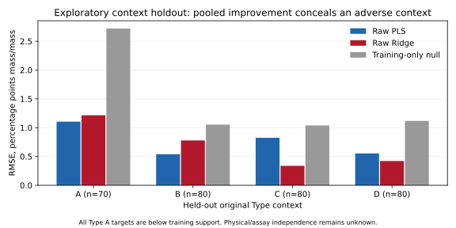

# First real exploratory pilot — UCPH tablets

The separately authorized [frozen design](ALPHA17_TABLET_PILOT_PLAN.md) completed
on 2026-10-19: all **310 observations × 404 bands**, four outer Type holdouts,
three inner Type holdouts per outer fold, both fixed raw anchor grids, **104
native model fits and four training-only FlexiblePCA fits**. Canonical observation
keys map explicitly to original record keys and the co-located active-substance
target. No unkeyed canonical Y join, row deletion, fold redraw or outcome-based
descriptor selection. Known canonical blocks remain whole; physical/assay
independence remains unknown.

| Pooled OOF outcome | Raw PLS | Raw Ridge | Training-only null |
|---|---:|---:|---:|
| RMSE, percentage points mass/mass | .77739 | .75184 | 1.59950 |
| MAE, percentage points mass/mass | .63537 | .57987 | 1.34247 |
| R² | .63868 | .66204 | −.52961 |
| S = 1 − RMSE / RMSE_null | .51398 | .52995 | reference |

Each OOF observation is evaluated exactly once by each model family. Inner
selection and refitting see only outer-training rows; the null uses only the
corresponding training outcomes. The quantitative reference is active substance
% mass/mass, not an identifier or category code. Retained targets are not used.

| Held-out original Type | n eval | PLS RMSE | Ridge RMSE | PLS R² | Ridge R² | Targets outside training range |
|---|---:|---:|---:|---:|---:|---:|
| A | 70 | 1.10423 | 1.21574 | −5.38107 | −6.73479 | 70 below |
| B | 80 | .53875 | .77827 | .41056 | −.23007 | 1 above |
| C | 80 | .82390 | .33757 | −.42181 | .76132 | 0 |
| D | 80 | .55301 | .42128 | .32700 | .60943 | 0 |

Observation: both pooled models improve on their training-only null, but Type A
has uniformly extrapolating target values and negative R² for both models.
Confidence: exact keyed descriptive OOF comparison on the frozen populations;
there is no independent-study confidence interval. Consequence: pooled skill
conceals substantial context dependence. Action: retain all four contexts and
target-support diagnostics in future comparisons.

Ridge has lower pooled error yet performs worse than PLS in A and B. These are
observed same-identity comparisons, without a statistical superiority or causal
claim. Neither an estimator nor a context is removed because it is unfavorable.

## Relationship to frozen unsupervised descriptors

Before any target decode, full-source raw PC1 fraction was **.99688**, SNV PC1
fraction **.64757**, and raw/SNV primary partition ARI **.09860**. These exact
alpha.13 profiles remain content-bound in the pilot packet. The source is highly
concentrated along raw PC1 and its partition changes with preprocessing; that
description alone does not ensure adequate transfer to every Type. Positive
pooled skill coexists with weak representation agreement and a failed context.

This is the first exploratory pairing of these frozen source descriptors with
the approved predictive response. A single population cannot establish a
cross-dataset descriptor/performance relationship. There is no matched random-CV
reference, structural stress design or whole-component size control, so registered
`D_RMSE` and `D_skill` remain unavailable. H1–H5 are not retrospectively retuned
or declared confirmed. Target range, source composition and spectral support are
not experimentally isolated; the result identifies no causal shortcut fraction.

Each diagnostic FlexiblePCA was fitted on outer train, then transformed train
and evaluation without refit. PC1/2 score summaries are available. Qualified
continuous-support scores and exact full train covariance moments remain
unavailable; no exact moment is invented from the 20-component PCA.

The actual worker completed in **3.234 seconds**, with a **198.99 MiB** lifetime
resident peak, including imports. These observations are distinct from the
prospective 1-hour/1-GiB stop limits. The task reserved 8 MiB; the shared campaign
now reserves **804,650,450 / 805,306,368 bytes**, leaving 655,918 bytes. No further
real fits or acquisitions are implied by that small remainder.

The [aggregate JSON](benchmarks/alpha17/tablet-pilot-summary.json) includes all
model/context scores, selected parameters, train-fitted diagnostics, missingness
and resource observations. Source keys, fold rosters and OOF vectors remain in
the protected local evidence. Source and attribution: Dyrby, Engelsen, Nørgaard,
Bruhn and Lundsberg Nielsen (2002), *Applied Spectroscopy* 56(5), 579–585,
[UCPH development data](https://ucphchemometrics.com/tablet/), under the
[source index public-use conditions](https://ucphchemometrics.com/datasets/).
