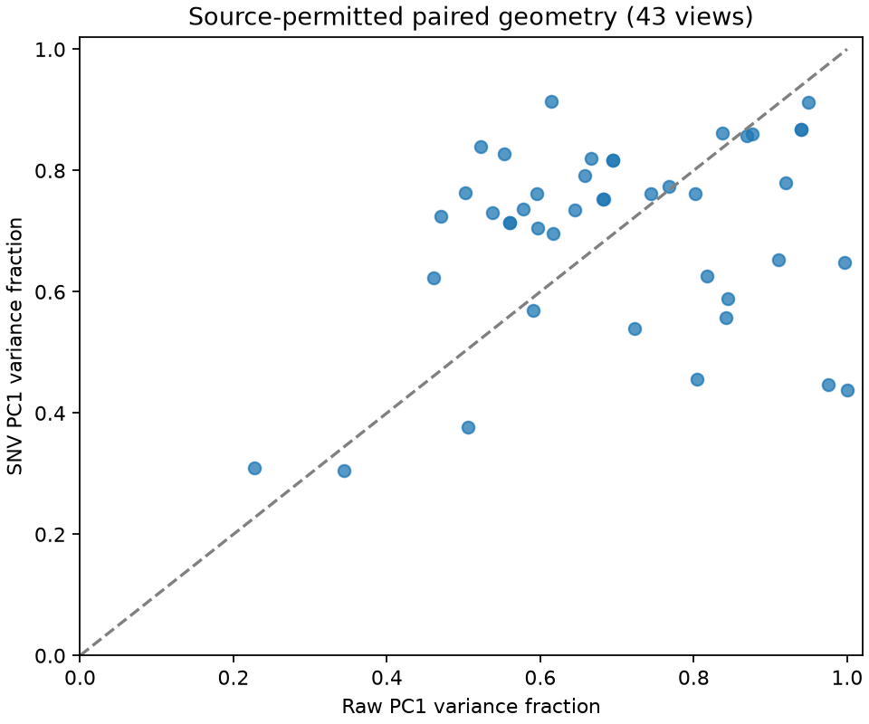
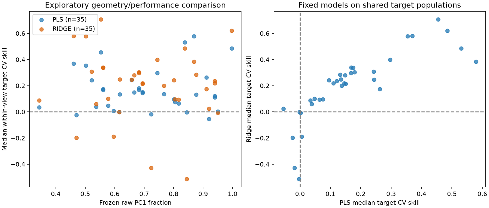

# Full-bank structural characterization and exploratory model confrontation

The campaign now links frozen X-only descriptors to actual fixed-model outcomes across a diverse existing bank. These are exploratory comparisons; no universal shortcut score or independently validated generalization claim is produced.

## Scientific coverage

All **164 catalog entries / 171 source views** and **2,054 declared source/target tasks** are inventoried. Complete raw/SNV profiles cover **137/171** views (137/163 locally analysis-authorized views), up from 56. The 56 exact prior profiles were reused, not refitted. New X attempts: 95; 81 succeeded, 14 failed. Eight failures have nonfinite X; six are two-observation views rejected by the current CLI entry contract. The latter is a local adapter limitation, not proof of invalid data. Twelve larger views are resource-deferred, and eight views remain outside the preserved analysis authorization. No source observation or band was removed to meet a numeric threshold.

Reference task accounting: `{"computed": 713, "failed": 599, "ineligible": 721, "partial": 5, "unavailable": 16}`. Native reference fitting: **4353 finite fit/predict completions / 4368 pipeline model attempts**, including diagnostic executions. Mathematical pre-fit guards can reject an attempt before a native fit call. The primary quantitative subset has **682 complete tasks / 4107 successful fits**. All tasks retain actual eligibility, target population, missingness, failure and publication states in the [experiment matrix](campaign/experiment-matrix.md). Five numeric classification labels were excluded before decoding outcomes. A subsequent full target-name audit corrected further identifiers/counters and separated context, model-derived and unresolved QC endpoints. Already executed diagnostics remain visible and count as execution, but do not enter the primary quantitative synthesis. Selection uses metadata meaning, not favorable scores. Source-declared predicted traits and spectral indices also remain visible outside the primary screens.

Full local confrontation joins **48 source views**; **35** have permitted public numeric outcomes and descriptors. All authorized private-tier sources enter the same scientific workflow. Unknown publication terms restrict only outgoing numbers, not local analysis. Local full matrices, comparison screens and outcomes remain in the existing protected evidence store. Counts of sources, targets and folds are not counts of independent studies.

## What the data show

| Observation | Confidence | Consequence | Action |
|---|---|---|---|
| Complete paired X profiles increased from 56 to 137, while every one of 171 views is accounted for. | High for execution and frozen source identities; descriptive geometry is observation-conditional. | Broader structural diversity is measurable without assuming biological independence. | Use the full descriptor matrix; retain cost, nonfinite-data and low-n limitations explicitly. |
| 713 source/target tasks have complete fixed-model reference results; negative scores and failed folds are retained. | Native executable outcomes under frozen scopes; target meaning, missingness and physical dependencies remain source-specific. | We can compare model response with pre-outcome descriptors, rather than infer predictive usefulness from X geometry alone. | Separate ordinary CV skill from matched stress deterioration; compare unit-free outcomes across targets. |
| The post-hoc raw-PC1 >= .95 / negative-median-skill screen finds 0 cases; 11 source/family records have negative median skill overall. | Descriptive post-hoc counterexample screen, not a preregistered H1-H5 decision rule. | An empty threshold screen is a null result for that screen, not evidence that high concentration certifies generalization or low shortcut risk. | Preserve the null screen, all negative-skill cases and the directly observed stress/pipeline contrasts. |
| 6 public source/family matched stress pairs are available; no independently confirmed study-level descriptor/fragility relationship exists. | Exploratory paired evaluation; training composition and target support still limit causal interpretation. | Neither a convenience bank nor many targets/folds establishes independent scientific replication. | Use the paired effects as exploratory evidence and register later independent study validation separately. |
| None of the six available descriptor screens exceeds absolute Pearson correlation .50 with median primary-task CV skill for either fixed model. | Native fixed-threshold descriptive tests on 15 to 35 permitted source views; no signed coefficient, adjustment or independent study inference. | These screens provide no evidence of a strong linear source-view association with ordinary CV skill. They do not test every form of predictive usefulness or registered deterioration endpoint. | Retain the null screens and test prespecified matched fragility endpoints with independent study support. |
| SNV increases matched stress deterioration for both models on aquatic-leaf LMA, reduces it on tablets, and has opposite signs for PLS and Ridge on leaf nitrogen. | Executed raw/SNV contrasts with identical evaluation IDs, exact training-size controls and a common null denominator; small exploratory context populations. | Preprocessing sensitivity depends on both source context and estimator; no universal SNV correction or scalar shortcut ranking follows. | Preserve estimator-by-pipeline interactions and extend matched, prospectively specified context comparisons. |
| Whole-plot CV worsens both fixed models on pressed-leaf nitrogen, but improves PLS and worsens Ridge on the Plant_Age task; NASA-leaf EWT changes are close to zero. | Five metadata-selected declared-plot tasks, common evaluation observations; training sizes and compositions differ and plots are not independently verified biological units. | Grouping effects are heterogeneous; a stronger declared grouping does not guarantee a uniform direction or magnitude of score change. | Retain small, negative and estimator-opposed effects; use matched-size designs before interpreting grouping effects causally. |

Per-view medians use the SAME complete primary quantitative target tasks for both families. Partial/failed cases remain in the full matrix, with their successful family results. Target mixtures differ across views and original assay origins are not fully verified. Values below zero are worse than the fold-local training mean. These are source-view distributions, without study-level confidence intervals. Raw unscaled X and fixed Ridge alpha=1 imply different effective regularization across source intensity units; these are results for the frozen pipelines, not optimized estimator potential.

| Fixed model | Source views | Median skill | IQR | Views with negative median skill |
|---|---:|---:|---|---:|
| PLS | 35 | 0.13719 | 0.042949 to 0.24294 | 5 |
| RIDGE | 35 | 0.2363 | 0.090575 to 0.3226 | 6 |

### Structural variation across the permitted bank

These native summaries describe source views, without assuming independent studies. n is the number of available metric values, which can be lower than the source count. Exact effective dimension is reported only where the required full moments exist; truncated PCA is not substituted. HDBSCAN uses the frozen min-cluster-size 12 setting. Similar marginal cluster counts do not imply similar memberships.

| Descriptor | Representation | n | Median | IQR | Range |
|---|---|---:|---:|---|---|
| clusters_12 | raw | 43 | 2 | 2 to 4 | 0 to 18 |
| effective_dimension | raw | 17 | 1.6338 | 1.3891 to 2.2786 | 1.0063 to 4.9763 |
| neighbor_cv | raw | 43 | 0.49798 | 0.3864 to 0.5762 | 0.29444 to 10.31 |
| noise_12 | raw | 43 | 0.249 | 0.084149 to 0.38221 | 0.0040589 to 1 |
| pc1_fraction | raw | 43 | 0.68256 | 0.56892 to 0.8431 | 0.22753 to 0.9999 |
| raw_snv_ari | raw | 41 | 0.22612 | 0.098603 to 0.47832 | -0.034485 to 0.94783 |
| raw_snv_overlap | raw | 43 | 0.3125 | 0.27105 to 0.38525 | 0.045898 to 0.70984 |
| clusters_12 | snv | 43 | 2 | 2 to 4 | 0 to 15 |
| effective_dimension | snv | 17 | 1.8568 | 1.6341 to 2.5838 | 1.3325 to 6.1428 |
| neighbor_cv | snv | 43 | 0.43002 | 0.34642 to 0.52897 | 0.15236 to 2.1235 |
| noise_12 | snv | 43 | 0.20525 | 0.11914 to 0.33635 | 0.0095969 to 1 |
| pc1_fraction | snv | 43 | 0.73638 | 0.62459 to 0.81706 | 0.30442 to 0.91425 |

Raw and SNV both have median two detected clusters, while median raw/SNV ARI is only .226 and neighborhood overlap .3125. Thus apparently stable cluster counts can conceal substantial representation changes. These are structural observations, without evidence that the changed memberships are shortcut mechanisms.

### Fixed native association screens

The existing native filter tests strict absolute Pearson thresholds .50/.80/.95. It exposes neither a signed coefficient nor a p-value. These unadjusted source-view screens do not control n/p, target mixtures, study overlap or selection effects.

Descriptors characterize the complete source X; supervised outcomes use available development targets after sealed exclusions. Missingness can select a different population. Per-task denominators are preserved, and this mismatch limits interpretation of whole-source descriptor/outcome screens.

| Descriptor | Model | Paired views | abs(r) > .50 | > .80 | > .95 |
|---|---|---:|---|---|---|
| pc1_fraction | pls | 35 | false | false | false |
| pc1_fraction | ridge | 35 | false | false | false |
| effective_dimension | pls | 15 | false | false | false |
| effective_dimension | ridge | 15 | false | false | false |
| neighbor_cv | pls | 35 | false | false | false |
| neighbor_cv | ridge | 35 | false | false | false |
| proximity_0.01 | pls | 35 | false | false | false |
| proximity_0.01 | ridge | 35 | false | false | false |
| raw_snv_ari | pls | 33 | false | false | false |
| raw_snv_ari | ridge | 33 | false | false | false |
| raw_snv_overlap | pls | 35 | false | false | false |
| raw_snv_overlap | ridge | 35 | false | false | false |

### Contrary cases

The following post-hoc descriptive screen lists every source/family with raw PC1 >= .95 and negative median target CV skill. It is not a new registered risk threshold, and ordinary skill does not replace a deterioration endpoint.

| View | Fixed model | Raw PC1 | Median target CV skill |
|---|---|---:|---:|
| No matching case in the permitted primary subset | - | - | - |

All negative-median-skill source/family records are retained below, without adjusting the .95 screen to obtain a preferred result.

| View | Fixed model | Raw PC1 | Median target CV skill |
|---|---|---:|---:|
| cartilage_spectroscopy_scientificdata_nir/X | pls | 0.91998 | -0.054253 |
| ecosis_nasa_fft_project_leaf_reflectance_morphology_and_bioche_reflectance_nirs/X | pls | 0.61486 | -0.0015216 |
| ecosis_nasa_fft_project_leaf_reflectance_morphology_and_bioche_reflectance_nirs/X | ridge | 0.61486 | -0.0018739 |
| ecosis_nasa_fft_project_leaf_transmittance_morphology_and_bioc_transmittance_nirs/X | ridge | 0.94989 | -0.006759 |
| ecosis_ngee_arctic_2017_leaf_spectral_reflectance_teller_water_reflectance_nirs/X | pls | 0.72343 | -0.017672 |
| ecosis_ngee_arctic_2017_leaf_spectral_reflectance_teller_water_reflectance_nirs/X | ridge | 0.72343 | -0.42817 |
| ecosis_ngee_tropics_february_2017_leaf_spectral_reflectance_me_reflectance_nirs/X | pls | 0.47026 | -0.023918 |
| ecosis_ngee_tropics_february_2017_leaf_spectral_reflectance_me_reflectance_nirs/X | ridge | 0.47026 | -0.19719 |
| ecosis_ngee_tropics_gliht_puerto_rico_campaign_leaf_spectral_r_reflectance_nirs/X | ridge | 0.59644 | -0.18956 |
| ecosis_ngee_tropics_gliht_puerto_rico_campaign_leaf_spectral_r_transmittance_nirs/X | pls | 0.84409 | -0.0034346 |
| ecosis_ngee_tropics_gliht_puerto_rico_campaign_leaf_spectral_r_transmittance_nirs/X | ridge | 0.84409 | -0.51407 |

## Matched structural stress

Five source/context populations were selected before primary Y decoding, with historical sealed memberships protected. Final genuine target priority was corrected during the metadata audit after primary fits began and before ANY stress outcome; no predictive scores were used for that correction. These are exploratory comparisons, not untouched target-level confirmation. They preserve known groups, use identical evaluation observations and exact whole-component training-size controls. Full reference, size-control reference and context-excluded training remain separate. A positive D_skill means exclusion worsened error under the SAME size-control null denominator; a negative value is contrary to a simple expectation of deterioration. These effects still combine context, chemistry, training composition and target-range changes.

| View / target | Context | Model | Evaluation n | Matched training n | D_RMSE (target units) | D_skill |
|---|---|---|---:|---:|---:|---:|
| ecosis_leaf_reflectance_and_tratis_of_floating_and_emergent_ma_reflectance_nirs/X / LMA | year | pls | 12 | 83 | 4.246 | 0.10298 |
| ecosis_leaf_reflectance_and_tratis_of_floating_and_emergent_ma_reflectance_nirs/X / LMA | year | ridge | 12 | 83 | 3.5012 | 0.084918 |
| ecosis_leaf_spectra_structural_and_biochemical_leaf_traits_of_reflectance_nirs/X / N_pc_dry | species | pls | 8 | 143 | 0.087298 | 0.068949 |
| ecosis_leaf_spectra_structural_and_biochemical_leaf_traits_of_reflectance_nirs/X / N_pc_dry | species | ridge | 8 | 143 | 0.15465 | 0.12215 |
| ucph_tablet_nir/X / active_w_w | scale | pls | 20 | 190 | 0.44602 | 0.3139 |
| ucph_tablet_nir/X / active_w_w | scale | ridge | 20 | 190 | 0.39826 | 0.28029 |

### Raw/SNV pipeline interaction

All five previously selected stress tasks also receive the frozen SNV pipeline, without choosing cases using model scores. Exact private fingerprints verify identical training and evaluation memberships; both representations use the same null denominator. I_skill is D_skill_SNV minus D_skill_raw. A positive value means SNV increases stress deterioration relative to its own matched-size reference; it does not simply mean worse SNV accuracy.

| View / target | Model | I_RMSE | I_skill |
|---|---|---:|---:|
| ecosis_leaf_reflectance_and_tratis_of_floating_and_emergent_ma_reflectance_nirs/X / LMA | pls | 6.6215 | 0.1606 |
| ecosis_leaf_reflectance_and_tratis_of_floating_and_emergent_ma_reflectance_nirs/X / LMA | ridge | 4.5571 | 0.11053 |
| ecosis_leaf_spectra_structural_and_biochemical_leaf_traits_of_reflectance_nirs/X / N_pc_dry | pls | 0.12674 | 0.1001 |
| ecosis_leaf_spectra_structural_and_biochemical_leaf_traits_of_reflectance_nirs/X / N_pc_dry | ridge | -0.086694 | -0.068472 |
| ucph_tablet_nir/X / active_w_w | pls | -0.29666 | -0.20878 |
| ucph_tablet_nir/X / active_w_w | ridge | -0.40228 | -0.28312 |

The [prospective extension](ALPHA18_SNV_STRESS_PLAN.md) adds at most 30 model fits and 15 diagnostic PCAs, with 5 MiB of reservations inside unchanged ceilings. Source-permitted interaction screens are retained in the machine-readable confrontation; four or fewer public source cases cannot validate an independent-study relationship.

Every attempted stress task, including missing pairs and unfavorable values, is in [confrontation.json](campaign/confrontation.json). Train-only PC1 range diagnostics and target extrapolation counts provide limited support evidence; they do not represent full geometric residual coverage or causal shortcut attribution.

## Declared-plot sensitivity

Five additional source/target cases were selected by repeated plot metadata and a fixed semantic target priority, without using predictive scores. Experimental plot links are merged with existing components. The primary reference estimates within-context performance; whole-plot CV asks a stronger context question. Both OOF vectors are compared on the same available evaluation observations, with the grouped null as common denominator. Different training populations, sizes and one fixed allocation confound a pure causal interpretation. Plot aliases are declarations, not verified independent biological units.

| View / target | Model | Common evaluation n | D_RMSE | D_skill |
|---|---|---:|---:|---:|
| ecosis_2018_cedar_creek_pressed_leaves_reflectance_nirs/X / N | pls | 327 | 0.036241 | 0.060392 |
| ecosis_2018_cedar_creek_pressed_leaves_reflectance_nirs/X / N | ridge | 327 | 0.043818 | 0.073019 |
| ecosis_cucurbita_pepo_two_stresses_leaf_canopy_reflectance_nirs/X / Protein | pls | 249 | 0.038642 | 0.024594 |
| ecosis_cucurbita_pepo_two_stresses_leaf_canopy_reflectance_nirs/X / Protein | ridge | 249 | 0.0065893 | 0.0041938 |
| ecosis_hyperspectral_leaf_reflectance_biochemistry_and_physiol_reflectance_nirs/X / Plant_Age | pls | 118 | -0.072294 | -0.013631 |
| ecosis_hyperspectral_leaf_reflectance_biochemistry_and_physiol_reflectance_nirs/X / Plant_Age | ridge | 118 | 0.245 | 0.046194 |
| ecosis_nasa_fft_project_leaf_reflectance_morphology_and_bioche_reflectance_nirs/X / EWT_gDW_cm2 | pls | 981 | -0.22451 | -0.00049751 |
| ecosis_nasa_fft_project_leaf_reflectance_morphology_and_bioche_reflectance_nirs/X / EWT_gDW_cm2 | ridge | 981 | -0.30462 | -0.00067503 |
| ecosis_nasa_fft_project_leaf_transmittance_morphology_and_bioc_transmittance_nirs/X / Nmass_perc | pls | 448 | 0.0022184 | 0.0025299 |
| ecosis_nasa_fft_project_leaf_transmittance_morphology_and_bioc_transmittance_nirs/X / Nmass_perc | ridge | 448 | 0.0055796 | 0.006363 |

[Declared-plot protocol and bounds](ALPHA18_GROUP_SENSITIVITY_PLAN.md) preserve the original primary outcomes and explicit stronger-design limitations.

## H1-H5: what can and cannot be tested

| Frozen hypothesis | Current evidence | Remaining scientific limit |
|---|---|---|
| H1: reproducible separation / fragility | Descriptors and paired context outcomes can be confronted exploratorily | Calibrated stability is not available for every paired task; no independent study validation |
| H2: neighborhood overlap / interpolation | Fixed proximity screens and paired stress effects are available | Ordinary CV skill is not genuine-transfer deterioration; whole-source proximity is not train-to-evaluation coverage |
| H3: representation instability / pipeline interaction | Frozen raw/SNV-by-model-by-context interactions on matched populations | Five exploratory tasks and limited publication subset; no independent study validation or universal risk threshold |
| H4: continuous support without discrete groups | Concentration screens and train-only PC1 extrapolation diagnostics | One-PC ranges are limited; context comparisons do not isolate causal continuous-support shifts |
| H5: proximity / unresolved independence | Known components and retained memberships are preserved | No new independently verified physical/assay closure contrast, so the registered response is unavailable |

No H1-H5 definition or decision rule was changed after outcomes. The operational fixed-model grids and convenience contexts do not constitute the full later registered anchor/independent-confirmation design. Historical discovery populations remain historical; every new comparison is exploratory. Strong geometry alone is not a low-risk certificate; poor transfer alone does not identify a shortcut mechanism.

## Local blockers and the next scientific decision

Nonfinite X prevents the exact raw PLS/Ridge/PCA path on affected views; target descriptions remain available. No unqualified imputation or numerical Python fallback was substituted. Six two-row views need a bounded low-n geometry adapter that separates PCA from clustering requirements. Larger matrices need an explicitly costed extension. Three supervised views lack complete binding to already sealed historical populations; they do not block other views. Unknown physical and assay dependencies constrain independence claims, rather than ordinary admitted exploratory analysis.

The next computational decision is a prespecified missing-data/low-n technical qualification and broader supported stress contrasts, followed by supervised representation comparisons. Imported original-study evidence can improve interpretation through the [additive study contract](STUDY_EVIDENCE_IMPORT.md), without refitting frozen X descriptors. Do not restart unchanged source-owner investigations. Reserve independent studies and define confirmation designs before viewing their future outcomes.

## Resources and reproducibility

The owner authorized increases up to 5 Go per alpha without another approval question. This alpha uses the conservative SI sum: **+4,000,000,000 bytes combined-storage ceiling and +1,000,000,000 bytes cumulative-reservation ceiling = 5,000,000,000 bytes**. Current ceilings are 20,289,597,121 and 1,805,306,368 bytes. This is a ceiling/reservation change, not 5 GB of newly written scientific files. Existing whole export files were counted in participation; no raw acquisition, deletion or migration occurred. See the [concrete resource plan](ALPHA18_RESOURCE_PLAN.md), [execution qualifications](ALPHA18_EXECUTION_NOTES.md) and final [validation/resource measurement](audit/alpha18-validation.json).

The [existing execution receipts](campaign/scientific-execution-resources.json) record 1,343.314 seconds of new X worker time and 2,490.310 seconds of reference worker time, including worker overhead. The largest conservative sum of separate X Python/native high-water marks is 781,520,896 bytes; the reference process peak is 542,420,992 bytes. Raw/SNV stress adds 48 successful model fit/predict completions and declared-plot CV adds 30. The initial raw-stress watchdog race is explicitly qualified in the execution notes; final OS high-water marks were below 2 GiB, but that run is not presented as clean continuous enforcement. Null-only continuation completes 382 target tasks with zero model fits. These timings do not measure all campaign, null-continuation or engineering time.

Methods1.3.6, DAG-ML0.3.41 and the qualified native X executable own all numerical operations. Python bridge is 0.1.0a18; unchanged Rust crates remain 0.1.0-alpha.16. Native model parameters are fixed; no favorable-score task selection, broad HPO, TabPFN or B60 prerequisite. Historical artifacts, source restrictions and journal reservations remain intact. Actual local/native/package gates and final-source Windows/Ubuntu CI are recorded separately from scientific fitting.

[Protocol](ALPHA18_SCIENTIFIC_PROTOCOL.md) · [Stress estimands](ALPHA18_STRESS_ESTIMANDS.md) · [Source attribution](campaign/source-attribution.md) · [Machine-readable findings](campaign/scientific-findings.json) · [Structural matrix](campaign/source-matrix.md)
