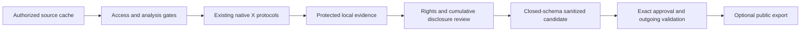
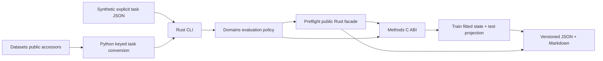

# Architecture and ownership

Alpha.17 adds the small `exploratory.admit` evidence-tier decision in the existing
Python transport package. It does not change strict `confrontation` admission,
invent physical identities or authorize fitting. Existing Methods summary and
correlation APIs compare already executed profiles; native Methods/DAG retains
all fitting. Ordinary source-permitted aggregates follow actual source terms,
without catalog-tier veto or repeated owner byte approval. Historical private
storage, secrets and frozen evidence remain protected. A fixed-code inspection
command addresses the identified shell-output boundary. No new crate, numerical
backend, generic privacy framework or upstream change. Python is alpha.17;
unchanged Rust binaries/crates remain alpha.16.

The historical protected-export diagram below still applies to explicitly
sensitive/restricted material. Ordinary permitted aggregates use the simpler
alpha.17 source-permission path, without a fresh owner byte-review transaction.

Alpha.16 adds an explicit original-manifest binding and required-field keyed
comparison adapter in the existing Python transport package. It introduces no
numerical backend or crate. Protected source-resolution controllers reuse
PrivateStore and the same cumulative StageStore journal. Read-only original
header/container-schema reconciliation and exact owner requests are separate
from target decoding and the existing native supervised execution gate.

Alpha.15 adds thin `cohort`, `synthesis` and `confrontation` Python orchestration
modules. Cohort accounting joins declared source/content/receipt identities;
synthesis reuses compact profiles and calls public Methods summary, factor and
correlation ABIs. No numerical kernel moves into Domains. Source-closed pilot
freezes reuse native DAG grouped selection/refit and existing stage checkpoints.
The two Rust crates remain unchanged in structure. Protected execution uses the
existing PrivateStore/HMAC scope and shared cumulative StageStore journal;
new evidence stays in a version-specific subdirectory, preserving old keys,
maps, scientific receipts and signed publication review.

Alpha.14 adds a private transport/publication boundary in the existing Python
bridge. `privacy` owns permission gates, owner-protected external evidence and
scoped HMAC mappings; `private_batch` reuses the serial cumulative StageStore and
unchanged native raw/SNV characterization; `disclosure` and `publication` own
closed-schema review and outgoing bytes. No new crate or numerical kernel.
Private X remains in its original authorized cache. Original source contracts,
fingerprints, identities, labels, neighborhoods and B60 panels stay protected.
The shared scheduler records opaque task references and resource accounting.
Public schemas and synthetic tests contain no real confidential source data.

Publication is separate from fitting. Unknown fields, permissions, participation
clearance or byte bindings refuse export without deleting scientific evidence.
OS ACLs and separate secrets reduce accidental disclosure, not administrator or
same-user process access. Identity preservation does not certify independence.

Alpha.13 adds serial `x-profile-stream` transport in the existing CLI, calling
unchanged native characterization with fresh contexts. No kernel or third crate
is added. New Python modules own task-specific component exposure, pair allocation,
compact restart, rights-scoped X admission, CSV key projection and study-role/
response guards. Methods/Preflight retain all numerical operations; DAG-ML owns
any later admitted fitting/selection/refit. Source admission, original numeric
correspondence, physical/reference closure and confirmation power have separate
evidence. Missing generic seams are proposed in ALPHA13_ECOSYSTEM_GAPS.md without
upstream changes.

Alpha.12 adds `unsupervised.rs` and the target-free `x-profile` CLI within the
same two crates. Public Methods/Preflight provide PCA, full moments, exact
neighbors, HDBSCAN, ARI, summaries and factor association. Python owns field
projection, keyed protocol assembly, component subsets and immutable StageStore
transport. Full-source descriptive fits are separate from prospective train-fit
support. Query batches retain all references/axes. Schemas are additive; prior
numerical modules/results are frozen. See ALPHA12_UNSUPERVISED_PROTOCOL.md and
ALPHA12_EXECUTION_NOTES.md for ownership and atomic prefix restart semantics.

Alpha.11 adds an observation-scoped `x-structure` stdin contract in the existing core/CLI crates. It bypasses physical-unit admission for descriptive X geometry, without inventing physical identities or using a target. Existing Methods PCA, Preflight native neighbor/summary providers and Methods HDBSCAN/ARI own all numerical work. Streamed input avoids persistent duplicate matrices; Python transports keys, axes and information-level evidence.

Original-key adapters and stricter reference/physical closure still gate MODEL. Repeated grouped designs reuse the unchanged native DAG/Methods fitting seam and keep refit sensitivity separate from frozen-OOF bootstrap. The corrected source adapter filters retained reference cells before numeric comparison; its explicit correction preserves the initial audit and all model outputs. See ALPHA11_ADAPTIVE_CAMPAIGN_PROTOCOL.md and ALPHA11_RELEASE_REPORT.md.

Alpha.10 adds matched multi-family responses and exact whole-component size
matching in the existing Python bridge. Methods/DAG own classical fitting,
preprocessing, CV/selection/refit and all scores. At the owner's explicit request,
the optional nirs4all 1.4.10 FastAOM entry point owns its Python/NumPy/SciPy adaptive
calculations; Domains supplies identity-checked native scheduler callbacks and
copies no solver or preprocessing algorithm. This is a named experimental
provider, without a numerical fallback. It is distinct from native Methods
FastAOM branch-CV facades. Two crates remain sufficient.

Original-source adapters transport MAT-owned location/reference keys; a source
audit does not automatically admit a predictive task. New registry identities
carry the additive qualification protocol and link the frozen alpha.9 parent.
The stage budget key groups the corresponding bounded protocol responses;
registry identities additionally carry the full standard task fields. Primary
evaluation and additional size-control manifests are separate immutable inputs.
See ALPHA10_MULTIFAMILY_PROTOCOL.md and ALPHA10_CARTILAGE_ADMISSION.md.

Alpha.9 keeps both crates and the existing bank stages. `admission.py` handles
rights/semantic/original-key decisions; `comparison.py` checks frozen development
contracts and invokes the existing native DAG-ML/Methods seam for fixed Ridge.
Dataset-specific scripts supply keyed transport and external Datasets cache
preparation. No solver, intrinsic QC kernel, source downloader or canonical writer
is reimplemented. All new source decisions and unavailable experiments remain
separate from benchmark purpose and estimator-family evidence.

Alpha.8 adds Python transport modules `inventory`, `storage`, `registry` and
`bank` within the existing bridge/two crates. P0 uses pinned public Datasets
descriptors/cards. Disk estimates/kernel serialization gate resumable P1–P4;
validated JSON is atomically published with content identities. Full-X JSON stays
in scratch for existing Rust contracts. Persistent evidence retains OOF/metrics/
lineage digests without X/loadings/N4ME copies. Methods/DAG ownership and prior
scientific algorithms/schemas are unchanged. Datasets remains the acquisition/
canonical owner. See STORAGE_AND_REPRODUCIBILITY.md and BENCHMARK_QUALIFICATION_MODEL.md.

Alpha.7 adds a separate `split-stress` workflow using the same Rust audit/mean
transport and Python predictive bridge. `group_folds` retains its default
identity-hash assignments and adds an explicit whole-component shuffle mode.
Factor closure, matching and target source-ID maps are bounded task protocols;
Methods still owns every model/summary/metric. The existing public DAG callback
now accepts a training-scope intervention before either raw-target or residual
PLS fitting. FIT_CV never receives an intervention source outside native train
IDs; SELECT scores original validation outcomes. Alpha.6 calls without the new
option retain their prior controller contract, folds and numerical behavior.
New report/config v1 schemas are separate. Frozen alpha.6 OOF is reused rather
than re-executing completed real experiments.

Alpha.6 adds `association.rs` and `group-target` within the same two crates.
Public Methods factor association and summaries provide descriptive physical-
unit variance decomposition. `dependence` invokes the existing Python predictive
bridge: original PLS stays on its unchanged callback-free native route; residual
PLS uses DAG-ML's public callback CV/SELECT/REFIT twin. Native data-view IDs bind
each fold-local target baseline and Methods PLS fit. Native N4ME replay restores
selected nondegenerate residual models. Exact-zero residuals are explicitly
degenerate baseline cases, with no PLS fit or fabricated N4ME artifact.
Singleton physical exports retain original JSON float values after renewed Rust
identity/reference auditing, avoiding a needless second numerical parse.
Separate config/report v1 schemas and protocol
`domains.structural_dependence.v0.1` preserve canonical/alpha.5 contracts.

Alpha.5 adds a separate structural report and CLI in the existing two crates.
`structure.rs` owns physical-unit selection, component subsampling, matched IDs,
support counts and exploratory classification. Methods supplies public ABI 2.19
HDBSCAN/ARI; native statuses/messages and nonfinite diagnostic reasons are
preserved. No numerical clustering or ARI algorithm is copied.

PCA refits once per component draw, independently of HDBSCAN parameters. All
settings use that draw's same fitted scores, with their own reference partitions
and stability evidence. Only train X enters fits. Canonical alpha.4 reports and
the optional predictive workflow retain separate semantics. Test HDBSCAN labels
and spectral-cluster-derived OOF prediction remain unavailable. Alpha.6 metadata
association/baselines are separate workflows described above; split interventions
remain specified only in STRUCTURAL_SHORTCUT_RISK.md.

Audit date: 2026-10-16. The methodological Word document
`qualification_nirs_architecture_plan(1).docx` (working version 2026-09-14) was
opened as OOXML and read. This implementation follows the user's narrower first
intervention: audit, contracts and one train/test vertical slice.

| Owner | Exact boundary |
|---|---|
| Datasets | Catalog, content versions, provenance, sources, canonical Parquet, access/cache, native split labels. A catalog dataset is not a modeling task. |
| Formats / IO | Vendor decoding, materialization and declared relational assembly. Domains does not parse vendor spectra or infer joins. |
| Preflight | Intrinsic validity, linked identities, duplicate suspicions, technical repeatability, target description, descriptive X-Y checks and their alpha limitations. |
| Methods | PCA/SVD, covariance moments, summary statistics, distances/neighbors, preprocessing, PLS/PCR/Ridge, HDBSCAN/ARI and generic association kernels. |
| Domains | Select task and allowed populations; train-reference projection and coverage; evaluation-policy guards; comparisons, provenance, result mapping, recommendations and campaigns. |
| DAG-ML | Inner group CV, native selection and REFIT in the optional development probe. Domains assembles explicit outer identity scopes and replays selected Methods artifacts. |

Two crates suffice: `nirs4all-domains` owns contracts, a safe Methods adapter and
domain protocols; `nirs4all-domains-cli` owns commands/files/process invocation.
`bridges/python` converts public Datasets accessors, runs independent tasks and
orchestrates the bounded native DAG-ML predictive probe. Splitting a contract-only core crate is deferred until a second native
consumer needs it. There is no frontend, WASM demo or R/MATLAB binding.

The small additional C ABI adapter is necessary because Preflight's
`PcaDiagnostics` drops loadings even though its native provider allocates them.
Domains needs them to apply the train-fitted transform to test. It calls the same
public `n4m_preflight_pca_compute`, retains caller-owned loadings and requests
column means through Preflight's Methods summary provider. There is no new PCA,
summary or neighbor algorithm. Affine transform application, reconstruction and
scalar comparisons of domain summaries are protocol assembly.

Alpha.4 additionally retains the opaque public Methods FlexiblePCA fitted handle
and calls its public transform on train/test. Column summary variances give full
trace, while the exact squared covariance trace is an independent optional call
with its own budget/failure reason. Public zero/coordinate transforms recover
the fitted affine operator for reconstruction; no private state is read. PCA
scores and coverage do not depend on obtaining full moments. All primary 390
train acquisitions and 2151 columns remain present. Native state lifetimes are
bound to the loaded library, and every handle is destroyed before unloading.

Coverage bootstrap resamples whole held-out dependency components with one
physical-sample flag mean per sample. A separate train-component bootstrap
refits the selected view's PCA and fences, preserving bootstrap multiplicity.
Neither operation reads Y. `represent` exports the exact native-built comparison
view with audited component membership for the optional predictive workflow.

The predictive adapter uses DAG-ML 0.3.41's published native CV/SELECT/REFIT
binding on each explicit outer-train population. Methods restores its exported
PLS artifact and predicts the corresponding outer holdout. Folds, lineage and
native summaries/metrics are retained in a separate report. It introduces no
numerical model or generic validation engine. See PREDICTIVE_SANITY_CHECK.md.

Two contexts may reference the same explicit shared library: the Preflight
provider and the retained-loading adapter. Neither transfers handles to the
other; each destroys its own context before unloading its library. Contexts stay
on their creating thread. ABI checks and buffer dimensions precede native calls.

Input v1 deliberately models **one spectral source and axis per task**. A source
cannot be fused with another by row position. Cross-instrument paired tasks need
a later explicit paired protocol; equal axes alone do not establish independence.
Incompatible axes require an externally declared transformation, not silent
interpolation. Repeated observations retain their physical IDs and measurement
context. Alpha.3 optionally builds a homogeneous technical-mean task view using
the public Methods summary mean. Eligibility, membership and physical-sample
weights belong to this Domains comparison policy; native Preflight measurement
diagnostics remain separate. Linked cross-context rows remain in the inventory
and are excluded from pooled geometry. Preflight's private averaging step was
inspected but is not exposed as a reusable representation API.

The public Preflight model cannot carry test reference identity without an exact
target value. Domains therefore checks cross-partition reference ID and reference
group keys as part of its evaluation policy, without accessing test Y. Connected
dependencies are exported for future validation; reference-only anomalies block
X-Y without discarding X diagnostics. Context aliases adapt Preflight's sample
model while retaining physical identity. Contradictory repeat groups have distinct
aliases so its private structural averaging cannot silently fuse them. Safe
train targets are deduplicated by declared reference and physical identity.
The narrow upstream contracts are proposed in UPSTREAM_DEPENDENCIES.md.

The alpha.2 local pilot runner delegates raw regeneration to an existing,
SHA-pinned data-project converter and canonical writing to Datasets. It is a
local qualification script, not a new source parser in Domains. The normal
bridge still consumes public Datasets getters. Native third partitions can be
explicitly excluded, with their IDs/counts retained. Target units are optional
in input v1 and passed through to Preflight; older tasks remain valid.

Reports are deterministic for a fixed task, binary and engine version. They omit
wall-clock timestamps and durations from the scientific payload. A sanitized
task hash intentionally excludes hidden Y_test; the native binary hash records
the selected numerical provider. This is scientific reproducibility rather than
a full raw-file chain-of-custody record.
