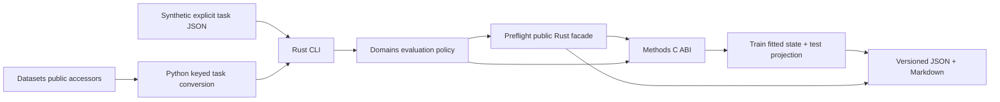

# Architecture and ownership

Alpha.5 adds a separate structural report and CLI in the existing two crates.
`structure.rs` owns physical-unit selection, component subsampling, matched IDs,
support counts and exploratory classification. Methods supplies public ABI 2.19
HDBSCAN/ARI; native statuses/messages and nonfinite diagnostic reasons are
preserved. No numerical clustering or ARI algorithm is copied.

PCA refits once per component draw, independently of HDBSCAN parameters. All
settings use that draw's same fitted scores, with their own reference partitions
and stability evidence. Only train X enters fits. Canonical alpha.4 reports and
the optional predictive workflow retain separate semantics. Test HDBSCAN labels
and group-derived OOF prediction remain unavailable. Structural reliance
experiments are specified in STRUCTURAL_SHORTCUT_RISK.md, not implemented.

Audit date: 2026-10-16. The methodological Word document
`qualification_nirs_architecture_plan(1).docx` (working version 2026-09-14) was
opened as OOXML and read. This implementation follows the user's narrower first
intervention: audit, contracts and one train/test vertical slice.

| Owner | Exact boundary |
|---|---|
| Datasets | Catalog, content versions, provenance, sources, canonical Parquet, access/cache, native split labels. A catalog dataset is not a modeling task. |
| Formats / IO | Vendor decoding, materialization and declared relational assembly. Domains does not parse vendor spectra or infer joins. |
| Preflight | Intrinsic validity, linked identities, duplicate suspicions, technical repeatability, target description, descriptive X-Y checks and their alpha limitations. |
| Methods | PCA/SVD, covariance moments, summary statistics, distances/neighbors, preprocessing, PLS/PCR/Ridge, HDBSCAN/ARI and generic association kernels. |
| Domains | Select task and allowed populations; train-reference projection and coverage; evaluation-policy guards; comparisons, provenance, result mapping, recommendations and campaigns. |
| DAG-ML | Inner group CV, native selection and REFIT in the optional development probe. Domains assembles explicit outer identity scopes and replays selected Methods artifacts. |

Two crates suffice: `nirs4all-domains` owns contracts, a safe Methods adapter and
domain protocols; `nirs4all-domains-cli` owns commands/files/process invocation.
`bridges/python` converts public Datasets accessors, runs independent tasks and
orchestrates the bounded native DAG-ML predictive probe. Splitting a contract-only core crate is deferred until a second native
consumer needs it. There is no frontend, WASM demo or R/MATLAB binding.

The small additional C ABI adapter is necessary because Preflight's
`PcaDiagnostics` drops loadings even though its native provider allocates them.
Domains needs them to apply the train-fitted transform to test. It calls the same
public `n4m_preflight_pca_compute`, retains caller-owned loadings and requests
column means through Preflight's Methods summary provider. There is no new PCA,
summary or neighbor algorithm. Affine transform application, reconstruction and
scalar comparisons of domain summaries are protocol assembly.

Alpha.4 additionally retains the opaque public Methods FlexiblePCA fitted handle
and calls its public transform on train/test. Column summary variances give full
trace, while the exact squared covariance trace is an independent optional call
with its own budget/failure reason. Public zero/coordinate transforms recover
the fitted affine operator for reconstruction; no private state is read. PCA
scores and coverage do not depend on obtaining full moments. All primary 390
train acquisitions and 2151 columns remain present. Native state lifetimes are
bound to the loaded library, and every handle is destroyed before unloading.

Coverage bootstrap resamples whole held-out dependency components with one
physical-sample flag mean per sample. A separate train-component bootstrap
refits the selected view's PCA and fences, preserving bootstrap multiplicity.
Neither operation reads Y. `represent` exports the exact native-built comparison
view with audited component membership for the optional predictive workflow.

The predictive adapter uses DAG-ML 0.3.41's published native CV/SELECT/REFIT
binding on each explicit outer-train population. Methods restores its exported
PLS artifact and predicts the corresponding outer holdout. Folds, lineage and
native summaries/metrics are retained in a separate report. It introduces no
numerical model or generic validation engine. See PREDICTIVE_SANITY_CHECK.md.

Two contexts may reference the same explicit shared library: the Preflight
provider and the retained-loading adapter. Neither transfers handles to the
other; each destroys its own context before unloading its library. Contexts stay
on their creating thread. ABI checks and buffer dimensions precede native calls.

Input v1 deliberately models **one spectral source and axis per task**. A source
cannot be fused with another by row position. Cross-instrument paired tasks need
a later explicit paired protocol; equal axes alone do not establish independence.
Incompatible axes require an externally declared transformation, not silent
interpolation. Repeated observations retain their physical IDs and measurement
context. Alpha.3 optionally builds a homogeneous technical-mean task view using
the public Methods summary mean. Eligibility, membership and physical-sample
weights belong to this Domains comparison policy; native Preflight measurement
diagnostics remain separate. Linked cross-context rows remain in the inventory
and are excluded from pooled geometry. Preflight's private averaging step was
inspected but is not exposed as a reusable representation API.

The public Preflight model cannot carry test reference identity without an exact
target value. Domains therefore checks cross-partition reference ID and reference
group keys as part of its evaluation policy, without accessing test Y. Connected
dependencies are exported for future validation; reference-only anomalies block
X-Y without discarding X diagnostics. Context aliases adapt Preflight's sample
model while retaining physical identity. Contradictory repeat groups have distinct
aliases so its private structural averaging cannot silently fuse them. Safe
train targets are deduplicated by declared reference and physical identity.
The narrow upstream contracts are proposed in UPSTREAM_DEPENDENCIES.md.

The alpha.2 local pilot runner delegates raw regeneration to an existing,
SHA-pinned data-project converter and canonical writing to Datasets. It is a
local qualification script, not a new source parser in Domains. The normal
bridge still consumes public Datasets getters. Native third partitions can be
explicitly excluded, with their IDs/counts retained. Target units are optional
in input v1 and passed through to Preflight; older tasks remain valid.

Reports are deterministic for a fixed task, binary and engine version. They omit
wall-clock timestamps and durations from the scientific payload. A sanitized
task hash intentionally excludes hidden Y_test; the native binary hash records
the selected numerical provider. This is scientific reproducibility rather than
a full raw-file chain-of-custody record.
