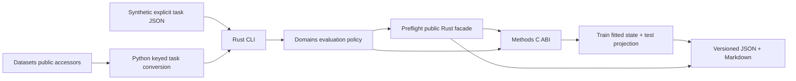

# Architecture and ownership

Audit date: 2026-10-16. The methodological Word document
`qualification_nirs_architecture_plan(1).docx` (working version 2026-09-14) was
opened as OOXML and read. This implementation follows the user's narrower first
intervention: audit, contracts and one train/test vertical slice.

| Owner | Exact boundary |
|---|---|
| Datasets | Catalog, content versions, provenance, sources, canonical Parquet, access/cache, native split labels. A catalog dataset is not a modeling task. |
| Formats / IO | Vendor decoding, materialization and declared relational assembly. Domains does not parse vendor spectra or infer joins. |
| Preflight | Intrinsic validity, linked identities, duplicate suspicions, technical repeatability, target description, descriptive X-Y checks and their alpha limitations. |
| Methods | PCA/SVD, covariance moments, summary statistics, distances/neighbors, preprocessing, PLS/PCR/Ridge, HDBSCAN/ARI and generic association kernels. |
| Domains | Select task and allowed populations; train-reference projection and coverage; evaluation-policy guards; comparisons, provenance, result mapping, recommendations and campaigns. |
| DAG-ML | Future fold/phase ownership, nested selection and OOF execution. No local CV replacement is introduced. |

Two crates suffice: `nirs4all-domains` owns contracts, a safe Methods adapter and
domain protocols; `nirs4all-domains-cli` owns commands/files/process invocation.
`bridges/python` only converts public Datasets accessors and runs independent
tasks. Splitting a contract-only core crate is deferred until a second native
consumer needs it. There is no frontend, WASM demo or R/MATLAB binding.

The small additional C ABI adapter is necessary because Preflight's
`PcaDiagnostics` drops loadings even though its native provider allocates them.
Domains needs them to apply the train-fitted transform to test. It calls the same
public `n4m_preflight_pca_compute`, retains caller-owned loadings and requests
column means through Preflight's Methods summary provider. There is no new PCA,
summary or neighbor algorithm. Affine transform application, reconstruction and
scalar comparisons of domain summaries are protocol assembly.

Two contexts may reference the same explicit shared library: the Preflight
provider and the retained-loading adapter. Neither transfers handles to the
other; each destroys its own context before unloading its library. Contexts stay
on their creating thread. ABI checks and buffer dimensions precede native calls.

Input v1 deliberately models **one spectral source and axis per task**. A source
cannot be fused with another by row position. Cross-instrument paired tasks need
a later explicit paired protocol; equal axes alone do not establish independence.
Incompatible axes require an externally declared transformation, not silent
interpolation. Repeated observations retain their physical IDs and measurement
context; geometric aggregation is currently refused.

The public Preflight model cannot carry test reference identity without an exact
target value. Domains therefore checks cross-partition reference ID and reference
group keys as part of its evaluation policy, without accessing test Y. This is a
small task-policy guard, not a copied intrinsic qualification algorithm. An
upstream identity-only reference contract is proposed in INTEGRATION.md.

Reports are deterministic for a fixed task, binary and engine version. They omit
wall-clock timestamps and durations from the scientific payload. A sanitized
task hash intentionally excludes hidden Y_test; the native binary hash records
the selected numerical provider. This is scientific reproducibility rather than
a full raw-file chain-of-custody record.
