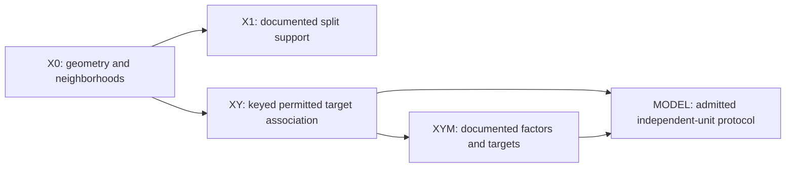

# Benchmark qualification model — domains.bank.v0.1

Alpha.12 separates observable geometry from independent-sample prediction.
Its 42-entry matrix has 39 raw/SNV sources, 22 complete neighbor censuses,
17 query samples, 37 variable-metadata sources and seven actually resampled views.
None meets the overall stability gate. Missing pair support is insufficient
information, not a biological finding. Two rechecked physical-key namespaces,
four historical ownership admissions, source views and cited references have
different denominators. Independent-population/study prevalence is unavailable.
See ALPHA12_CROSS_DATASET_RESULTS.md for exact aggregation limits.

Alpha.11 separates **structural susceptibility** (X or X/split), **structural target association** and **demonstrated estimator dependence**. Missing metadata, targets or physical identity do not block descriptive X evidence. Observation identity does not authorize independent-sample predictive evaluation. Every public entry receives supported stages and blockers; source-only evidence is shared across targets.

X0 uses descriptive full-source X. X1 fits training representations only on train. Any proposed split built using full X is transductive and must be frozen before Y evaluation. No held-out HDBSCAN assignment or nuisance label is invented.

New registry fields separate task properties, model response and benchmark suitability. Conditional litter preparation transfer remains useful despite unresolved higher biological support. Repeated fits keep one physical-ID denominator per design; the independent biological group count can remain unavailable when 24 declared blocks are evaluated. Limited-dependence membership remains empty; TabPFN remains gated.

Alpha.10 adds the backward-compatible purpose `within_population_estimator_comparison`
and a separate multifamily-result schema. Perten's pre-score evaluation manifest
fixes membership/content/folds; enriched response evidence and its hashes are
produced after execution and frozen for future comparisons. Purpose does not
depend on the new estimator's score. Structure-challenge and within-population
objectives coexist; transfer and low-dependence suites remain empty. Standard
estimator, tuning and adaptive-preprocessing response are distinct dimensions.
All fifteen pairwise interactions use matched original physical/reference IDs
and identical component draws. Compact artifact byte counts are metadata;
serialized numerical payloads remain prohibited.

New protocol identities link their unchanged alpha.9 parent; historical PLS and
fixed Ridge are not overwritten or relabeled as optimized equally. A small tuned
Ridge grid and the two adaptive families have explicit different search budgets.
Native Methods FastAOM availability does not qualify the separate nirs4all model.
See ALPHA10_MULTIFAMILY_RESULTS.md and the versioned alpha10 registry.

Alpha.9 adds `domains.admission.v0.1` and a packaged/root task-admission schema.
Four rights dimensions are independent. A documented quantitative measurement
and original specimen/reference alignment are required; numeric IDs and repeated
row counters cannot supply them. Perten admission is frozen before prediction.
Its structure-challenge suite is frozen before fixed native Ridge evaluation,
binding content, exact development folds and units. No suite membership changes
after those scores. Cereal sensitivity differs across PLS/Ridge; no estimator-
independent or low-dependence certificate follows. See ALPHA9_BENCHMARK_COMPARISON.md.

Expected behavior, fixed before alpha.8 tests and new scientific execution:

* P0 inventories metadata without acquisition, credentials or numeric outcomes.
  Restricted cards remain visible with explicit blockers. Catalog source variants
  are not independent cases; pairing requires exact declared sample keys.
* Dataset revision, benchmark task, execution and evidence are different identities.
  A task binds content/source/target/representation/split/independence/protocol.
  Execution additionally binds actual input/folds/preprocessing/models/config/
  numerical ABI and binary/source digests. Evidence hashes its scientific payload.
* A compact report contains matched physical-ID OOF predictions and original
  development truth, uncertainty summaries, per-group support and scoped fit
  digests. It never contains full X, PCA score matrices or repeated N4ME payloads.
  Retained Y_test remains absent. Existing same-scope native Methods/DAG-ML fits,
  component closure, size/range/intervention gates are unchanged.
* Group-only controls retain strong metadata baselines without being called low
  dependence. Within-group continuous controls retain spectral skill; mixed
  controls show both mechanisms. Independent-Y controls are not selected as clean
  benchmarks merely because structure is weak. Absent metadata and unqualified
  identities remain insufficient/ineligible. Paired instruments share sample
  components; equal row count or reordered rows cannot create a new sample join.
* Byte budgets reject before acquisition/fitting. A simulated crash leaves a
  running/partial attempt, and resume cannot advertise it computed. Input, target,
  split, model, ABI or protocol changes invalidate reuse. Unknown files, shared
  caches, links, current jobs and frozen evidence are never cleanup targets.
* Scientific scalar checks retain alpha.7 tolerances (analytical abs 1e-10,
  real replay exact within the same local binary/input contract). Storage hashes,
  integer bytes and portable identities use exact equality, no float tolerance.

Evidence status (`computed`, `exploratory`, `inconclusive`,
`insufficient_information`, `not_identifiable`, `unavailable`, `ineligible`,
`failed`) differs from intended benchmark purpose. Purpose tags are
`candidate_low_structural_dependence`, `structure_sensitive_challenge`,
`transfer_challenge`, `insufficient_evidence`,
`not_suitable_for_current_benchmark`. No universal probability or scalar rank.

Alpha.8 conservatively requires documented identities, meaningful X–Y signal,
independent-unit support and effective structural stress evidence before even
proposing a low-dependence candidate. Several estimator families must still
validate such a candidate later. Missing clusters, unavailable permutations or
missing metadata never fulfill those conditions. Current EcoSIS evidence supports
a structure-sensitive challenge, with explicit limits; no clean estimator-
comparison suite is certified here.

Suite selection filters evidence/purpose, fixes task/evidence hashes and metric/
split contracts, and serializes deterministically **before** evaluating a new
estimator. It has no estimator-performance input. A transfer task may be useful
even when unsuitable for clean estimator comparisons. Synthetic controls have a
separate domain and cannot populate a real benchmark suite.

Datasets integration is an external versioned sidecar: dataset/content/task ID,
Domains protocol, evidence URI/hash and purpose. No upstream cards are changed;
the sidecar does not embed source bytes, heavy archives or credentials.
