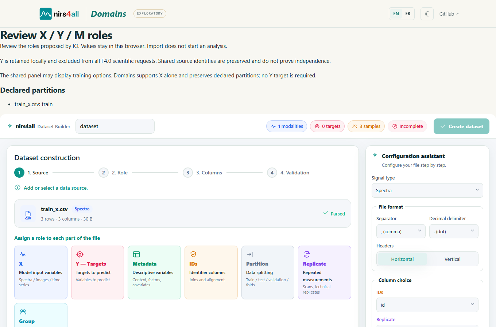
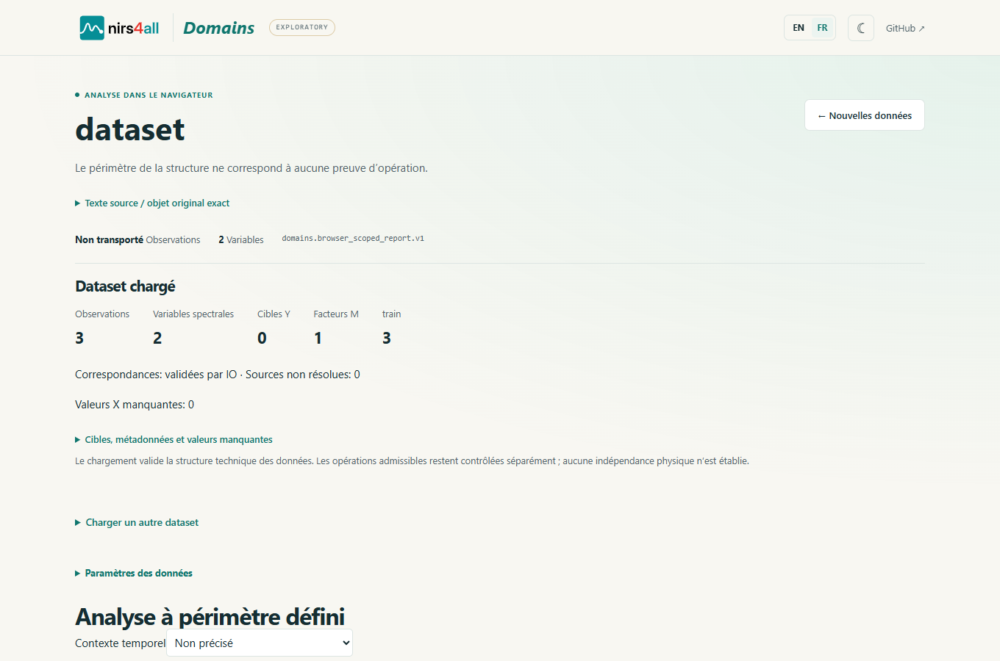

# One-shot import qualification

This targeted UX change starts from worker-loading PR #15, commit
`8549b2d87812afec65716e2256311624da67de3e`. It excludes PR #16/F4.3.
No Rust numerical code, dependency version, scientific protocol or saved
scientific example changes. No real-data calculations are performed.

## Observed interaction change

The earlier flow required at least three actions: submit files, confirm the
global roles checkbox, then press the second import button. The normal flow
now requires one file/folder submission. Thirty-five initial fixture submissions
record exactly one selection, zero correction submissions and zero settings
applications. Each completes the real `prepare_import` and `assemble_import`
workers. Import performs no numerical fit; later operations remain explicit.
Ambiguous cases have additional, separately recorded correction actions.

The earlier screenshot uses the existing read-only worker-loading build whose
build-info reports main `ada9ca3e44abf58011db5be04aadd580ada69e7f`, dirty=true.
It documents the earlier UX, not an independently reproducible clean #15 build.
Both screenshots contain synthetic data only.

| Earlier mandatory editor | Immediate loaded dataset (French) |
| --- | --- |
|  |  |

## Execution evidence

- Local front-end suite: 246 tests in 29 files passed.
- Production Vite build and TypeScript check passed. Static distribution:
  16,138,714 bytes, 82 files and four WASM assets.
- Build-tool notice preservation contract passed.
- Actual installed Windows Chromium: 48 one-shot scenarios passed using
  published IO/Formats 0.2.14 and UI 0.2.5. Fixtures exercise combined and
  separate X/Y/M, inferred and explicit roles, keyed reordering, multiple M,
  mixed/missing/all-missing Y/M, partial M, preserved empty spectral bands,
  train/test directories, actual JCAMP-DX decoding, refusal of generated random
  partitions, source ambiguity, detached auxiliary tables, delimiter
  correction, post-load provenance/evidence invalidation, transactional failed
  replacement, cancellation, replacement in flight, opt-in settings and saved
  reports. Both literal directory names and a directory containing `fold` pass.
- English landing and French loaded-screen automated accessibility checks pass.
  No off-origin or non-GET data request occurs in this qualification.

Local proof is retained under ignored `demo/test-results/full-local-05/`;
its `one-shot/receipt.json` records cases and gesture counters. Failed earlier
attempts remain available. The full legacy browser suite and hosted CI results
are recorded separately in the PR, on the exact published commit; a configured
workflow or this local helper is not evidence of their success.

The existing `Domains browser qualification` matrix invokes the new helper in
Chromium and Firefox on both Windows and Ubuntu, alongside all existing
worker-fault, train/test, factor/support, export, PDF, parity and distribution
gates. No gate or tolerance is removed. Scientific and warning-report contract
workflows remain required. The PR stays draft until actual checks pass.

## Limits and preserved boundaries

An IO assembly validates technical loading, not physical independence,
experimental design, predictive usefulness or transfer. X-only loading remains
available when independently validated auxiliary attachments are unresolved.
Duplicate/ambiguous keys and explicit strict-coverage violations remain visible;
their tables are not silently joined or converted into metadata. Files stay in
the current session for correction, with no new persistent dataset store.

IO owns supported formats and token handling. In 0.2.14, blank, `NA`, `N/A`,
`NaN`, `null`, `NULL` and `None` are missing; `.` and `missing` are not equivalent
tokens. Entirely missing targets retain their declarations and masks, without
claiming an inferred task distribution. Spectral materialization is float32;
original byte hashes do not imply lossless decimal parsing. Native validation
fold declarations stay in session but are not executed during import. Explicit
random split generation, aggregation and repetition execution remain refused.

The shared builder exposes training-oriented hints; these are not an admission
decision for Domains. Changing settings revalidates IO and invalidates dependent
live evidence only when the replacement succeeds. An isolated `.json` is a
saved-report import; dataset configurations use `.nirs4all.json` with their
files. Import budgets remain 8 MiB/32 files. Automated accessibility does not
replace human screen-reader evaluation.

## Resources and later integration

No resource ceiling or scientific reservation is increased. The staged local
engineering allowance is 512 MiB inside the existing cumulative 8,000,000,000
bytes; effective local cap remains 30,000,000,000, maximum 50,000,000,000 and
volume reserve 2 GiB each. Scientific reservations remain
2,015,788,498 / 2,023,410,176 bytes. The final PR records actual storage and
historical hash verification. Existing failed receipts and journals are kept.

After review and qualification, F4.3 can incorporate this branch through a
controlled merge/rebase, then rerun its own incomplete numerical/PDF gates.
That integration is not performed here. This PR does not merge, deploy, tag,
release, rebuild native kernels locally or modify another repository.
