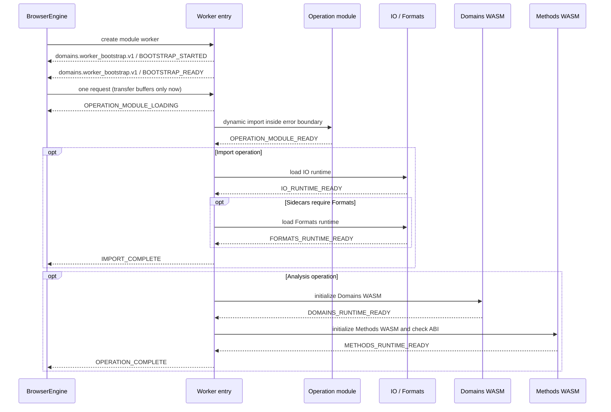

# Worker and WASM bootstrap contract

## Purpose and scope

The worker lifecycle must make module loading and runtime initialization
observable before an import or analysis is considered ready. Events describe
completed or currently entered phases; they do not estimate progress. A
failure must preserve the last confirmed phase and the component that reported
it. The contract adds transport diagnostics only; IO, Domains, Preflight, and
Methods retain their existing parsing, protocol, and numerical ownership.

## Startup and request sequence

`domains.worker_bootstrap.v1` startup messages use request ID `0`; the host
accepts only valid `BOOTSTRAP_STARTED` and `BOOTSTRAP_READY` messages. It does
not post the user request before READY. This ensures worker creation is not
mistaken for successful module evaluation, and import buffers are not detached
before the worker confirms it can receive the request. Each worker handles at
most one scientific operation. Existing request IDs, obsolete-reply rejection,
timeouts, and actual cancellation by worker termination remain in force.

The worker entry imports request types only. It installs uncaught-error and
unhandled-rejection handlers, announces bootstrap, assigns its message handler,
and then announces READY. It dynamically imports the requested operation
module inside a `try/catch`; static module loading errors from that operation
graph can therefore be returned as a structured refusal. Import and analysis
modules are not loaded until requested.

## Runtime phase ownership

| Phase | Owner | Confirmation means |
| --- | --- | --- |
| `WORKER_CREATED` | BrowserEngine | The Worker constructor returned. |
| `BOOTSTRAP_STARTED`, `BOOTSTRAP_READY` | Worker entry | The entry executed and installed its message handler; READY is emitted last. |
| `OPERATION_MODULE_LOADING`, `OPERATION_MODULE_READY` | Worker entry | The selected operation chunk is being imported, then its import completed. |
| `IO_RUNTIME_LOADING`, `IO_RUNTIME_READY` | Import assembly | The published IO module has initialized. |
| `FORMATS_RUNTIME_LOADING`, `FORMATS_RUNTIME_READY` | Import assembly | Formats has initialized when sidecar handling requires it. |
| `DOMAINS_RUNTIME_LOADING`, `DOMAINS_RUNTIME_READY` | Domains binding | Rust WASM initialization resolved. |
| `METHODS_RUNTIME_LOADING`, `METHODS_RUNTIME_READY` | Domains binding | Methods' public `loadModule()` resolved and ABI 2.20-or-newer was accepted. |
| `IMPORT_RUNNING`, `IMPORT_COMPLETE` | Import assembly | The selected import step is executing, then its result was assembled. |
| `OPERATION_RUNNING`, `OPERATION_COMPLETE` | Worker operation | The requested analysis/interpreter call is executing, then completed. |

The Methods 1.3.13 binding's public `loadModule()` has no configuration
argument: it dynamically imports its generated Emscripten loader and calls the
factory with `{}`. Internal `locateFile` / `wasmBinary` hooks are not exposed
by that public wrapper. Domains' `wasmModule` option applies only to the
Domains Rust binding. The optional Domains lifecycle callback can accurately
bracket Domains initialization, Methods initialization, and ABI acceptance;
it cannot report subphases hidden inside Methods' loader. Vite's generated
hashed asset URL remains the owner-resolved Methods WASM path. Do not patch the
generated loader, globally intercept `fetch`, or claim a Methods asset status
or integrity check that the public API did not observe.

## Error envelope and privacy

Worker refusals keep the shared `rt_error.v1` wire object closed to its schema:

- Required: `verb`, `cause`, `message`.
- Optional: `mitigation`, `unsupported_capability`, `portable_level`.
- `verb`: `inspect`, `validate`, `plan`, `run`, `predict`, `replay`, `explain`,
  or `export`.
- `cause`: `unsupported_shape`, `unsupported_capability`, `unavailable_backend`,
  `invalid_request`, or `runtime_error`.
- `message`, `mitigation`, and `unsupported_capability` are strings when
  present; `portable_level` is an opaque string or null.

The installed `nirs4all-ui@0.2.5` `runtime` entry exports
`normalizeRuntimeDiagnostics` and `formatRuntimeRefusalText` for presentation.
These helpers are not schema validators; Domains must validate and construct a
valid envelope before passing it to them. The UI intentionally treats
`portable_level` as opaque. It maps the wire envelope into a display item and
does not expose `portable_level`.

Technical fields belong to the separate `domains.worker_diagnostic.v1`
extension, not extra keys on `rt_error.v1`. That extension carries operation,
current and last-confirmed phase, diagnostic code/category, component, demo
version/commit, optional allowlisted asset path/status/content type/hash,
whether an original message exists, recoverability, and remediation. Asset
paths are same-origin and restricted to the app's generated asset namespace;
credentials, query strings, arbitrary remote URLs, source rows, target values,
file contents, and raw error text are not placed in the technical diagnostic.

`runtime_error` is a wire cause, not a severity label. UI's normalizer gives
that cause an informational tone unless a separate UI state supplies severity;
the closed wire schema does not permit an ad hoc `severity` property. A
technical diagnostic panel can show phase and recovery context without
misrepresenting the `rt_error.v1` contract.

## Recovery and limits

- A confirmed worker script 404, HTML response, or invalid JavaScript content
  type may offer an explicit application reload because the deployed asset
  graph is inconsistent.
- An inconclusive network probe remains `WORKER_STARTUP_CAUSE_UNAVAILABLE`;
  it must not invent a 404 or accuse the dataset.
- A recoverable operation failure may be retried only after explicit user
  action, with a fresh worker. Cancel terminates the active worker; it does not
  produce partial results or start a replacement automatically.
- Loader phase events only claim what their owner confirmed. Methods' public
  loader does not expose whether an internal rejection happened at asset
  fetch, compilation, or instantiation; retain its original message when
  available and report `METHODS_RUNTIME_LOADING` without guessing a subphase.
- The production-preview Chrome receipt verifies IO WASM 404, wrong MIME,
  corrupt bytes, and missing exports, plus a Domains WASM 404 and an
  incompatible Methods ABI. These are synthetic loader checks, not scientific
  qualification. Formats failures, Methods fetch/compile subphases, asset
  digests/integrity checks, Firefox, publication, and broader recovery remain
  pending. The Methods public API does not expose internal loader subphases.
